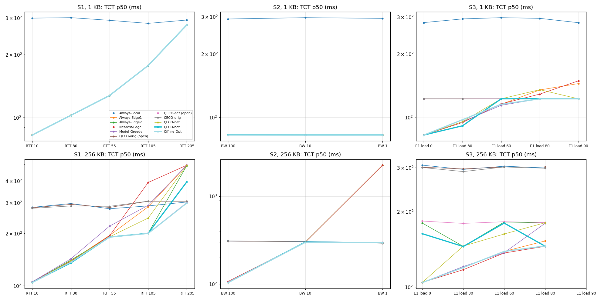
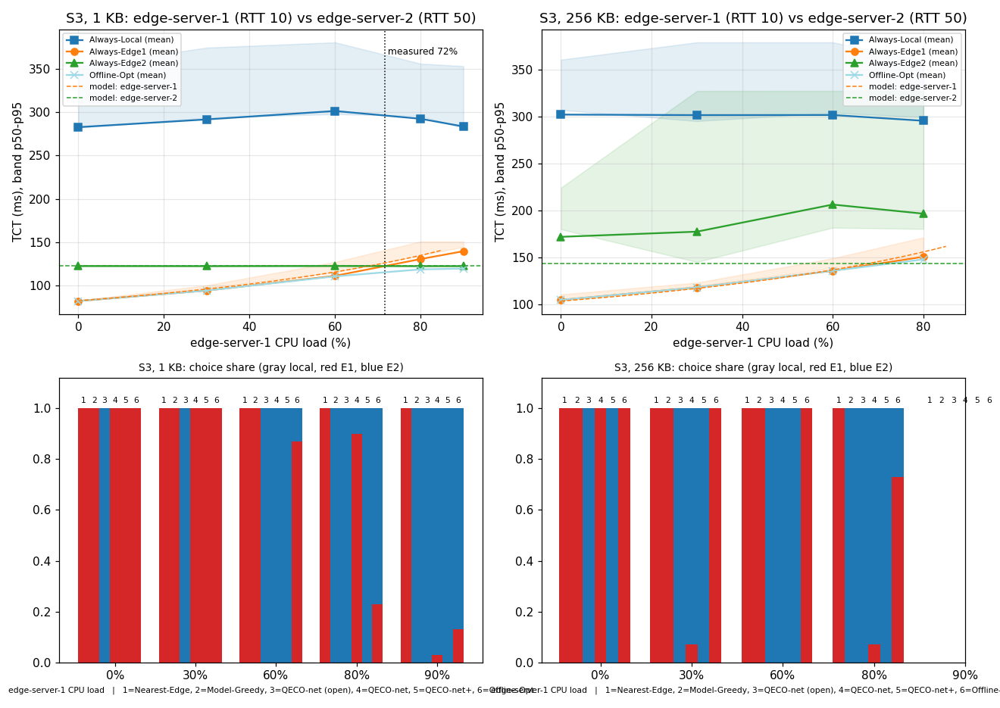
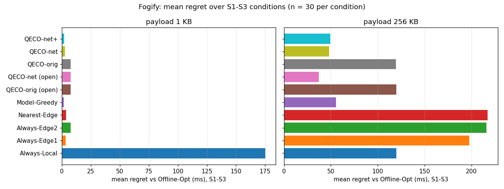
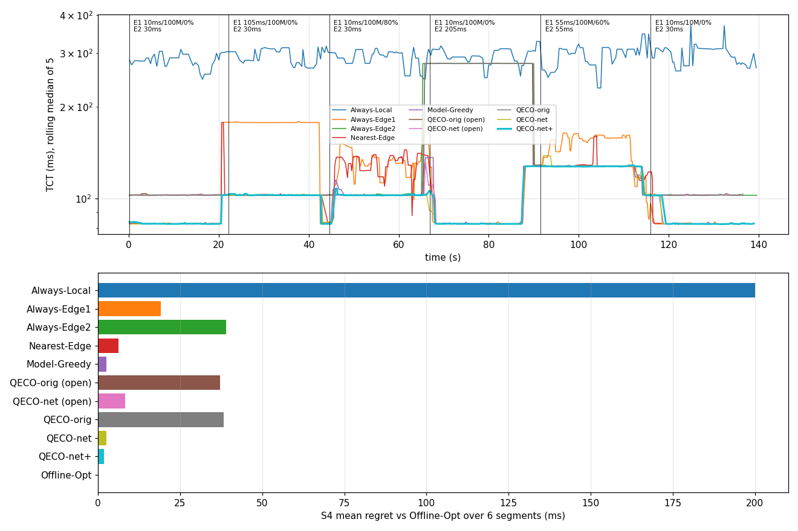
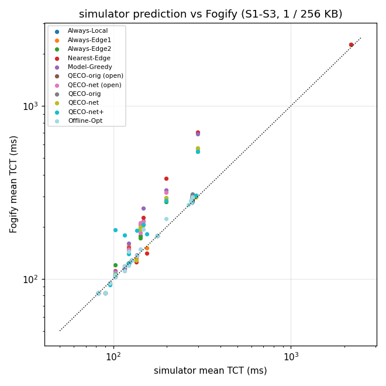

# QECO × Fogify: 네트워크·엣지 서버 자원 상태를 고려한 학습 기반 동적 작업 오프로딩

Phase 6 최종 정리 문서다. 단계별 상세 기록은 [`qeco-fogify/`](qeco-fogify/README.md) 폴더에 있다.
브랜치는 `exp/qeco-fogify`, 코드와 결과는 `examples/qeco-fogify/`에 있다.

## 요약

1. 엣지 서버가 로컬보다 약 4~5배 빠른 테스트베드에서, **1KB 작업은 RTT 약 200 ms까지 엣지 서버가 유리**하다.
2. **256KB 작업은 TCP slow start 때문에 실측 손익분기 RTT가 약 105 ms**이다. 크기 ÷ 대역폭 식이 예측한 약 200 ms의 절반이다. 이 식을 쓰는 시뮬레이터, Model-Greedy, 학습 정책이 모두 같은 이유로 틀렸다. slow start를 끄면 식과 1~3 ms 안으로 맞고 손익분기도 약 200 ms로 돌아와, 원인이 확인됐다 (RQ1).
3. 가깝지만 바쁜 엣지 서버(RTT 10)가 멀지만 한가한 엣지 서버(RTT 50)보다 느려지는 CPU 부하는 **약 72%**이다. 모델 예측은 68%로 맞았다. 부하 90%에서 RTT만 보는 Nearest-Edge는 27 ms 손해를 보고, 부하를 보는 정책은 3 ms 손해를 본다 (RQ2, 1KB).
4. 네트워크·부하를 보는 학습 정책(QECO-net / net+)은 사후 최적 대비 손해 2~3 ms로 규칙 기반 Model-Greedy(1.6~2.6)와 비슷했다. 조건이 실행 중에 바뀌는 S4에서는 **QECO-net+가 1.9 ms로 가장 좋았다** (RQ3).
5. **QECO의 sim-to-real gap이 실측으로 확인됐다.**
   - 작업 도착 방식이 학습과 실행에서 다르면(open-loop vs closed-loop) 손해가 약 3배가 된다 (7.5 vs 2.7 ms).
   - 원본 QECO 상태(큐 길이만)로는 네트워크 변화를 따라가지 못해 "작업 크기만 보는 고정 규칙"이 된다 (S4 손해 38 ms).

## 1. 연구 질문

| RQ | 질문 | 실험 |
|---|---|---|
| RQ1 | 로컬과 엣지 서버가 뒤바뀌는 지점(break-even)은 RTT, 대역폭, CPU 부하에 따라 어디인가 | S1 (RTT), S2 (대역폭) |
| RQ2 | 엣지 서버가 여러 대이고 상태가 서로 다르면 선택이 어떻게 달라지는가 | S3 (가깝고 바쁨 vs 멀고 한가함) |
| RQ3 | 학습 기반 정책이 고정 규칙·휴리스틱 정책보다 나은가 | S1~S4 전체, 시뮬레이터 vs 실측 |

**용어**
- **로컬:** 작업이 생긴 기기.
- **엣지 서버:** 로컬과 클라우드 사이의 서버.
- **TCT:** 로컬에서 작업 시작부터 결과 수신까지 걸린 시간.
- **사후 최적(Offline-Opt):** 각 작업을 세 위치에서 모두 실측한 뒤 가장 짧은 TCT를 고른 이상적 기준으로, 실측 TCT의 하한이다.
- **손해(regret):** 정책 평균 TCT − 사후 최적 평균 TCT.

## 2. 설계

### 2-1. 테스트베드 (Fogify)

```
              edge-server-net-1 (tc: RTT, 대역폭)
 ┌─────────┐ ───────────────────────────────▶ ┌────────────────────┐
 │ local   │                                  │ edge-server-1      │ 2 CPU, 코어 8·9 (E코어 묶음 A)
 │ 0.2 CPU │ ───────────────────────────────▶ ├────────────────────┤
 │ 코어 14 │   edge-server-net-2              │ edge-server-2      │ 2 CPU, 코어 12·13 (E코어 묶음 B)
 └────┬────┘                                  └────────────────────┘
      │ uvc-client agent :8081  (POST /run?target=local|edge1|edge2, GET /probe)
 ┌────┴───────────────────────┐      ┌──────────────────────────────┐
 │ driver.py (ui 컨테이너)     │ ───▶ │ qeco-policy (TF, :8090)      │
 │ 관측 0.5초 → 정책 → 실행   │      │ QECO 모델 추론               │
 └────────────────────────────┘      └──────────────────────────────┘
```

| 항목 | 설정 | 근거 |
|---|---|---|
| 작업 | SHA-256 iter 1M, payload 1KB / 256KB | 기존 uvc-sha256 앱 |
| 로컬 계산 능력 | 0.2 CPU (`clock_speed: 417`) | 엣지 서버가 약 5배 빠르게. 스마트폰·IoT와 서버의 차이(3~10배)의 중간 ([phase3_5](qeco-fogify/phase3_5.md#2-1-로컬-cpu-05--02-엣지-서버가-약-5배-빠르게)) |
| 엣지 서버 | 2 CPU, 작업 하나에 1코어, 연산 72.1 ms | Phase 4.5 보정 |
| CPU 격리 | 노드마다 다른 물리 코어 (`docker update --cpuset-cpus`) | Phase 1: 엣지 서버 1에 부하를 걸어도 엣지 서버 2 변화 −0.3% |
| CPU 고정 | performance 거버너, E코어 깊은 절전 끔 (`host/cpu_perf.sh`) | Phase 4.5: 엣지 서버 연산이 67.7~90 ms로 흔들림 → 72.1 ± 0.4 ms |
| 작업 도착 | closed-loop: 앞 작업이 끝나고 평균 200 ms(지수분포) 쉬고 다음 작업 | 실시간 앱의 프레임 처리 방식 |
| 상태 관측 | RTT_i: `/probe` 왕복 (0.5초마다), B_i: 설정값, L_i: cAdvisor CPU 사용량 − 우리 작업 | Phase 4 |
| 다른 사용자 | 엣지 서버 CPU 부하(stress)로 대신 | 사용자는 1명 |

### 2-2. 시뮬레이터 (`qeco_sim/`, QECO 학습용)

| 항목 | 원본 QECO | 이 연구 |
|---|---|---|
| 로컬 | 2.6 GHz, 일정 속도 | CFS 할당량 20 ms / 100 ms 주기 (Docker 0.2 CPU), 작업 70 ms |
| 오프로딩 | 크기 ÷ 14 Mbps, RTT 없음 | 엣지 서버별 RTT_i + 크기 ÷ B_i + 연산 72.1 ms ÷ (1 − 0.526·L_i) + 0.15 ms |
| 엣지 서버 | 42 GHz를 20명이 나눠 씀 | 2코어 processor sharing, 배경 부하 L_i |
| 조건 | 고정 | RTT(로그 균등 5~250 ms), 대역폭(1~100 Mbit), 부하(0~90%)가 에피소드 중에 바뀜 |
| 도착 | open-loop | closed-loop (Fogify와 같은 간격 생성 함수) |
| 보상 | QoE (지연 + 에너지) | −TCT / 100 ms |
| 모델 | D3QN + LSTM (원본 그대로) | 같음. γ 0, 작업 크기 64·256KB 비율 60% |

**보정 결과 (기본 조건)**
- 1KB에서 시뮬레이터 예측 TCT는 Fogify 실측과 1~2 ms 안으로 맞는다.
- 로컬은 280 vs 295 ms로 5% 차이이다.

### 2-3. 정책

| 정책 | 결정 방법 |
|---|---|
| Always-Local / Always-Edge1 / Always-Edge2 | 고정 |
| Nearest-Edge | RTT가 가장 작은 엣지 서버 |
| Model-Greedy | 위 식으로 TCT를 예측해서 가장 작은 곳 |
| QECO-orig | 원본 QECO 상태 6개 (작업 크기, 큐 길이), 환경·보상만 바꿔 학습 |
| QECO-net | orig + 엣지 서버별 RTT, 대역폭, 부하 |
| QECO-net+ | net + 로컬 CPU 상태 (직전 로컬 작업 후 지난 시간, 그 TCT) |
| QECO-orig / QECO-net (open) | open-loop 도착으로 학습 (학습·평가 조건 불일치 비교군) |
| Offline-Opt | 같은 작업 순서로 따로 돌린 Always-* 세 결과에서 작업마다 최솟값 |

### 2-4. 시나리오

| | 엣지 서버 1 | 엣지 서버 2 | 반복 |
|---|---|---|---|
| S1 | RTT 10 / 30 / 55 / 105 / 205, 100Mbit | 같음 | 조건 × 정책 × 크기마다 n = 30 (10개씩 3라운드, 정책을 섞어 실행) |
| S2 | RTT 10, 100 / 10 / 1 Mbit | 같음 | |
| S3 | RTT 10, 부하 0 / 30 / 60 / 80% (+ 90%, 1KB) | RTT 50, 부하 0 | |
| 256KB 재실험 | S1~S3을 TCP slow start 끄고 다시 (`docker-compose-noss.yaml`) | | 같음 |
| S4 | 6개 구간(약 22초)마다 RTT·부하·대역폭이 바뀜 | RTT 30 → 205 → 55 | 정책당 1회, 1KB, 280~500개 작업 |

## 3. 실행 방법

```sh
# 0) Fogify (compose 프로젝트 fogemulator). 재부팅 뒤에는 다시 시작
docker compose -p fogemulator start
cd examples/qeco-fogify
sudo sh host/cpu_perf.sh on                     # CPU 고정 (재부팅하면 풀림)
UI="docker exec -w /home/jovyan/examples/qeco-fogify fogemulator-ui-1"
TF="docker run --rm -u 1000:1000 -v $PWD:/w -w /w/qeco_sim qeco-tf:0.1"   # 이미지는 tf/Dockerfile로 빌드

# 1) CPU 격리 확인 (Phase 1)
$UI python phase1_isolation.py
# 2) 원본 QECO 재현 (Phase 2, 약 25분)
docker run --rm -u 1000:1000 -v $PWD:/w -w /w -e QECO_EPISODES=1000 qeco-tf:0.1 python run_upstream.py results/P2_upstream
# 3) 시뮬레이터 보정과 학습 (Phase 4.5, 3.5)
$UI python phase35_calib.py
GAMMA=0 sh qeco_sim/run_p35.sh                  # QECO-orig/net/net+ × 시드 3, 병렬
for v in orig net; do $TF python train.py --variant $v --episodes 1000 --arrival open \
    --reward delay --gamma 0.9 --out ../results/P35_open_$v; done
$TF python phase35_eval.py                      # 시뮬레이터 평가
# 4) Fogify 비교 실험 (Phase 5, 약 1.5시간, 이어서 실행 가능)
$UI python phase5.py all
$UI python phase5_analyze.py
$UI python phase5_tables.py > results/P5_tables.md
# 5) 추가 실험: S3 부하 90% (1KB), 256KB를 slow start 끄고 다시
docker exec -e P5_S3_LOADS=90 -e P5_PAYLOADS=1 -e P5_ONLY=S3 -w /home/jovyan/examples/qeco-fogify fogemulator-ui-1 python phase5.py static
docker exec -e QECO_COMPOSE=docker-compose-noss.yaml -e P5_PAYLOADS=256 -e P5_OUT=results/P5_noss_runs.csv \
    -w /home/jovyan/examples/qeco-fogify fogemulator-ui-1 python phase5.py static
$UI python phase5_noss_analyze.py
```

ui 컨테이너가 만든 파일은 root 소유일 수 있다. 그때는 아래 명령으로 바꾼다.

```sh
docker exec -u root fogemulator-ui-1 chown -R 1000:1000 /home/jovyan/examples/qeco-fogify
```

## 4. 결과

### RQ1. 손익분기 (S1, S2)

**평균 TCT (ms)**, 굵은 값이 더 빠른 쪽이다.

| 조건 | 1KB 로컬 | 1KB 엣지 서버 | 256KB 로컬 | 256KB 엣지 서버 (slow start 켬, 기본값) | 256KB 엣지 서버 (slow start 끔) | 256KB 식 예측 (엣지 서버) |
|---|---|---|---|---|---|---|
| RTT 10 | 298 | **83** | 294 | **106** | **105** | 104 |
| RTT 30 | 297 | **103** | 298 | **154** | **136** | 124 |
| RTT 55 | 291 | **128** | 282 | **213** | **151** | 149 |
| RTT 105 | 294 | **178** | 298 | 292 (비슷) | **202** | 199 |
| RTT 205 | 295 | **278** | **294** | 565 (p95 1103) | 299 (비슷) | 299 |
| 100 Mbit | 294 | **83** | 301 | **105** | **104** | 104 |
| 10 Mbit | 298 | **83** | 308 | 300 (비슷) | 301 (비슷) | 293 |
| 1 Mbit | 296 | **83** | **296** | 2262 | 2268 | 2180 |

- 1KB는 RTT 205까지 엣지 서버가 낫다. 손익분기는 약 220 ms로, 식과 실측이 맞는다.
- **256KB의 실측 손익분기는 RTT 약 105 ms, 대역폭 약 10 Mbit이다.**
  - 식은 RTT 약 200 ms로 예측한다.
  - RTT가 클수록 실측이 식보다 훨씬 느리다. 엣지 서버 TCT에서 연산·RTT·전송을 빼고 RTT로 나누면 중앙값 0.8~0.9, 최대 3.9이다. 즉 RTT를 1~4번 더 왕복한다.
  - 원인은 리눅스 기본값 `tcp_slow_start_after_idle = 1`이다. 작업 사이에 쉬는 동안 혼잡 윈도우가 초기값으로 돌아가는 slow start 때문이다.
  - **컨테이너에서 이 값을 0으로 끄고 다시 재 보니, 엣지 서버 TCT가 식과 1~3 ms 안으로 맞고 손익분기도 약 200 ms로 돌아왔다.** 원인이 확인됐다.
- 즉, **실제 손익분기는 응용의 작업 간격과 TCP 설정에 따라 달라진다.** 크기 ÷ 대역폭만 보는 모델은 쉬었다가 보내는 큰 작업에서 엣지 서버를 과대평가한다.



### RQ2. 가깝지만 바쁜 엣지 서버 vs 멀지만 한가한 엣지 서버 (S3)

| 엣지 서버 1 부하 | 0% | 30% | 60% | 80% | 90% | 역전 |
|---|---|---|---|---|---|---|
| 1KB 엣지 서버 1 (RTT 10) | **83** | **95** | **112** | 131 | 140 | **약 72%** (모델 68%) |
| 1KB 엣지 서버 2 (RTT 50) | 123 | 123 | 123 | **123** | **123** | |
| 256KB 엣지 서버 1 (slow start 켬) | **105** | **118** | **136** | **151** | - | 0~80%에서 없음 (모델 68%) |
| 256KB 엣지 서버 2 (slow start 켬) | 172 | 178 | 206 | 197 | - | |
| 256KB 엣지 서버 1 (slow start 끔) | **104** | **116** | **137** | 153 | - | **약 70%** (모델 68%) |
| 256KB 엣지 서버 2 (slow start 끔) | 145 | 145 | 145 | **145** | - | |

**부하 90% (1KB)에서 정책별 손해:** Nearest-Edge **27.1 ms** (RTT만 보고 바쁜 엣지 서버 1을 고름), Always-Edge1 20.0, Model-Greedy 3.0, QECO-net+ 3.1, QECO-net 3.6 ms.

- 부하에 따른 엣지 서버 속도 모델(1 − 0.526·L)은 역전 지점을 4%p 안으로 맞힌다 (1KB, 그리고 slow start를 끈 256KB).
- slow start가 켜진 256KB에서는 먼 엣지 서버 2의 slow start 비용(p95 327 ms)이 커서 0~80%에서 역전이 일어나지 않는다.
- **역전점을 충분히 넘으면(90%) 네트워크만 보는 정책은 크게 손해 본다.** 서버 상태도 봐야 한다는 근거이다.



### RQ3. 학습 기반 vs 규칙 기반

**사후 최적 대비 평균 손해 (ms)**

| 정책 | S1~S3 1KB | S1~S3 256KB (slow start 켬) | S1~S3 256KB (slow start 끔) | S4 (동적, 1KB) |
|---|---|---|---|---|
| Always-Local | 175.5 | 119.7 | 129.1 | 200.1 |
| Always-Edge1 | 3.3 | 197.8 | 169.6 | 19.2 |
| Nearest-Edge | 3.6 | 217.2 | 169.3 | 6.3 |
| Model-Greedy | **1.6** | 55.6 | **4.0** | 2.6 |
| QECO-orig (open) | 7.5 | 120.0 | 129.3 | 37.1 |
| QECO-net (open) | 7.5 | **37.1** | 10.3 | 8.3 |
| QECO-orig | 7.5 | 119.6 | 127.6 | 38.2 |
| QECO-net | 2.7 | 48.1 | 6.3 | 2.6 |
| QECO-net+ | 2.1 | 49.5 | 9.4 | **1.9** |




- **1KB: 네트워크·부하를 보는 정책은 모두 사후 최적과 2~3 ms 안이다.**
  - 시뮬레이터가 정확한 영역에서는 식 기반 Model-Greedy가 학습 정책만큼 좋다.
  - 조건이 바뀌는 S4에서는 QECO-net+가 가장 좋다. 특히 엣지 서버 1에 부하 80%가 걸린 구간에서 차이가 컸다 (손해 2.6 vs Model-Greedy 8.9, Nearest-Edge 25.1).
- **학습·평가 조건 일치:** QECO-net의 손해가 open-loop 학습 7.5 → closed-loop 학습 2.7로 줄었다 (S4: 8.3 → 2.6).
- **로컬 CPU 상태 보강(net+):** 1KB에서 2.7 → 2.1 (S4: 2.6 → 1.9). 효과가 있지만 작다. 256KB에서는 오히려 조금 나쁘다 (slow start 끔: 6.3 → 9.4).
- **QECO-orig:** 네트워크·부하 정보가 없어서 "1KB는 엣지 서버 2, 256KB는 로컬"이라는 고정 규칙이 된다. 학습 조건을 맞춰도 같다.
- **256KB:** slow start가 켜져 있으면 학습 정책과 Model-Greedy가 모두 시뮬레이터의 전송 식을 믿어 같이 틀린다.
  - QECO-net (open)이 가장 좋은 것은 RTT가 클 때 로컬을 고르는 편향이 우연히 실제와 맞았기 때문이다.
  - slow start를 끄면 Model-Greedy 4.0, QECO-net 6.3 ms로 1KB와 같은 수준이 된다. **정책이 틀린 것이 아니라 전송 모델이 틀렸다.**

### 시뮬레이터 예측 vs Fogify 실측 (QECO-orig, QECO-net)

| | 1KB | 256KB 전체 | 256KB, RTT ≥ 55 | 256KB, slow start 끔 |
|---|---|---|---|---|
| QECO-orig | 1.2 ms | 18.1 ms | 15.1 ms | 18.3 ms |
| QECO-net | 1.8 ms | 53.6 ms | 141.7 ms | **4.0 ms** |
| (참고) Always-Edge1 | 1.8 ms | 47.2 ms | 142.4 ms | 11.0 ms |

- 표의 값은 같은 정책·조건에서 |실측 평균 − 시뮬레이터 평균|이다.
- QECO-orig의 오차가 작은 것은 256KB에서 늘 로컬을 고르기 때문이다.



## 5. 진행 중 발견한 문제

| Phase | 문제 | 처리 |
|---|---|---|
| 1 | 코어를 고정하지 않으면 엣지 서버 1의 부하가 엣지 서버 2를 27% 느리게 만든다 | 노드마다 다른 물리 코어로 고정 |
| 2 | 원본 QECO는 TF 1.15에서 실행되지 않는다. 원본 `MEC_Env.py:510`은 전송 대기 시간을 `t_ue_comp`에 넣는 버그가 있다 | TF 2.8 이미지 사용. 우리 시뮬레이터에서는 버그를 고쳐 둠 |
| 3 | QoE 보상으로 학습하면 "항상 로컬"로 무너진다 (보상 차이가 Q 값보다 너무 작음) | 보상을 −TCT로 바꿈 |
| 4 | 시뮬레이터 학습 모델이 테스트베드에서 "항상 로컬"을 골랐다. 학습은 open-loop(큐가 참), 실행은 closed-loop(큐가 늘 비어 있음)였다 | 시뮬레이터를 closed-loop로 바꿔 다시 학습 (Phase 4.5, 3.5) |
| 4.5 | 사후 최적을 한 작업에서 세 위치를 연달아 실행해 쟀더니, 엣지 서버가 3.7 ms 유리하게 측정됐다 | Always-* 세 정책을 따로 실행하고 작업마다 최솟값을 고르는 방식으로 바꿈 |
| 4.5 | 엣지 서버 연산이 쉬는 시간과 측정 구간에 따라 67.7~90 ms로 흔들렸다 | CPU 거버너를 고정하고 깊은 절전을 꺼서 72.1 ± 0.4 ms로 안정 |
| 3.5 | 로컬 0.5 CPU + RTT 균등분포에서는 엣지 서버가 이기는 상황이 6%뿐이라 9개 모델이 모두 "항상 로컬"로 무너졌다 | 로컬 0.2 CPU(엣지 서버 약 5배), RTT 로그 균등분포로 바꿈 |
| 5 | 강제로 끈 stress가 좀비로 남아 실행이 멈췄다. Fogify API로 건 stress는 10~30초 늦게 걸렸다 | 살아 있는 프로세스만 확인. S4에서는 같은 명령을 컨테이너에서 직접 실행 |
| 5 | 256KB에서 slow start 때문에 엣지 서버가 예측보다 최대 2배 느렸다 | 컨테이너에서 `tcp_slow_start_after_idle = 0`으로 끄고 256KB를 다시 재서 원인 확인 |
| 5 | 부하 80%는 역전점(72%) 바로 뒤라 Nearest-Edge의 손해가 작았다 (6 ms) | 부하 90% 조건을 추가 (Nearest-Edge 27 ms) |

## 6. 한계와 다음 단계

| 한계 | 다음 단계 |
|---|---|
| 시뮬레이터가 TCP slow start를 모델링하지 않는다 (끄면 맞는 것은 확인) | 쉰 뒤 첫 전송에 slow start를 넣은 전송 모델로 다시 학습해서, 기본 설정(켬)에서도 맞히기 |
| 사용자 1명, 다른 사용자는 CPU 부하로만 흉내 냈다 | 로컬 컨테이너 3~4개로 동시 오프로딩 (남은 E코어 안에서 가능) |
| Fogify 평가는 QECO 시드 1개(검증 기준으로 선택) | 시드 3개 모두 Fogify에서 평가 |
| 단일 PC 에뮬레이션 (E코어, 3.1 GHz 고정) | 실제 기기와 서버로 검증 |
| S4는 정책당 1회 실행이다 | 같은 시나리오를 여러 번 반복해 신뢰구간 계산 |
| QECO 결정 시간 3.1 ms(규칙 0.8 ms)는 TCT에 넣지 않았다 | 결정 시간을 포함한 TCT도 함께 보고 |

## 7. 단계별 문서

| Phase | 내용 | 문서 |
|---|---|---|
| 1 | 엣지 서버 CPU 격리 | [phase1-isolation.md](qeco-fogify/phase1-isolation.md) |
| 2 | 원본 QECO 재현 | [phase2-upstream.md](qeco-fogify/phase2-upstream.md) |
| 3 | 테스트베드 맞춤 시뮬레이터, QECO-orig / net 학습 | [phase3-sim.md](qeco-fogify/phase3-sim.md) |
| 4 | Fogify 드라이버, 기본 조건 실행 | [phase4-driver.md](qeco-fogify/phase4-driver.md) |
| 4.5 | 측정 방식 바로잡기, CPU 고정 | [phase4_5.md](qeco-fogify/phase4_5.md) |
| 3.5 | closed-loop 재학습, QECO-net+, 로컬 0.2 CPU | [phase3_5.md](qeco-fogify/phase3_5.md) |
| 5 | Fogify 비교 실험 S1~S4 | [phase5.md](qeco-fogify/phase5.md) |
