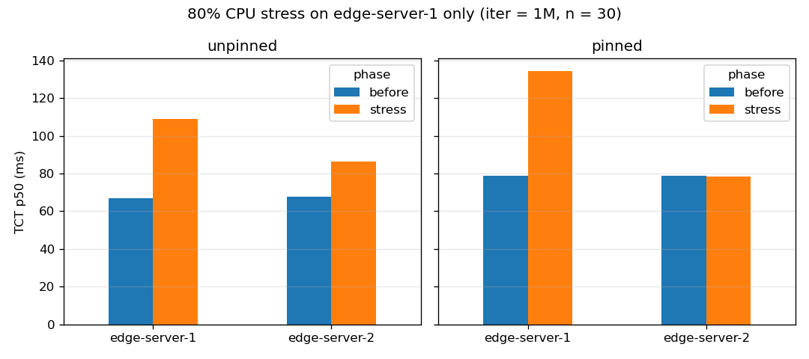

# Phase 1. 엣지 서버 CPU 격리 (cpuset) + 실험 D 재실행

## 문제

PC 한 대에서 엣지 서버들이 CPU를 공유한다. 그래서 edge-server-1에만 부하를 걸어도 edge-server-2까지 느려졌다 (uvc-sha256 실험 D: 65 → 133 ms).

## 방법

**코어 구조 (i5-1240P, 16 스레드)**

| CPU | 종류 | 비고 |
|---|---|---|
| 0-7 | P코어 4개 × HT 2 | 최대 4.4GHz. Fogify와 호스트가 사용 |
| 8-11 | E코어 묶음 A | 최대 3.3GHz. 묶음 안에서 L2·클럭 공유 |
| 12-15 | E코어 묶음 B | 위와 같음 |

**코어 고정**

| 노드 | 코어 | CPU 할당량 (Fogify) |
|---|---|---|
| local | 14 | 0.5 |
| edge-server-1 | 8, 9 (묶음 A) | 2.0 |
| edge-server-2 | 12, 13 (묶음 B) | 2.0 |

- Swarm 서비스 설정에는 cpuset 옵션이 없다. 그래서 배포 후 `docker update --cpuset-cpus`로 고정한다 (`testbed.pin_cpus()`).
- 고정은 컨테이너가 살아 있는 동안만 유지된다. 다시 배포하면 다시 걸어야 한다 (`testbed.deploy()`가 자동으로 건다).
- 두 엣지 서버는 서로 다른 E코어 묶음에 둔다. 같은 묶음에 두면 L2와 클럭을 통해 부하가 번질 수 있다.
- 부하(stress) 프로세스는 엣지 서버 컨테이너 안에서 돌기 때문에, 그 엣지 서버의 코어 안에 갇힌다.

**실험**
- 조건: iter = 1M, payload = 1KB, RTT ≈ 10 ms, 100Mbit, n = 30
- 측정 순서
  1. 부하 전 TCT 측정 (edge-server-1, edge-server-2)
  2. edge-server-1에 CPU 80% 부하 (90초) 시작
  3. 부하 중 TCT 측정 (edge-server-1, edge-server-2)
- "고정 안 함"과 "코어 고정" 두 조건으로 각각 측정했다.

## 결과

TCT (ms)

| 조건 | 대상 | 부하 전 p50 / p95 | 부하 중 p50 / p95 | p50 변화 |
|---|---|---|---|---|
| 고정 안 함 | edge-server-1 | 66.8 / 69.2 | 108.9 / 143.8 | +63.1% |
| 고정 안 함 | edge-server-2 | 67.8 / 72.4 | 86.3 / 102.1 | **+27.4%** |
| 코어 고정 | edge-server-1 | 79.0 / 81.1 | 134.3 / 139.1 | +70.1% |
| 코어 고정 | edge-server-2 | 78.8 / 80.7 | 78.6 / 82.2 | **−0.3%** |

엣지 서버 연산 시간 (`server_compute_ms`, p50)

| 조건 | edge-server-1 (부하 전 → 중) | edge-server-2 (부하 전 → 중) |
|---|---|---|
| 고정 안 함 | 56.1 → 98.4 | 57.0 → 75.9 |
| 코어 고정 | 67.7 → 123.7 | 67.6 → 67.8 |

로컬 처리 TCT (p50 / p95)

| 조건 | 로컬 처리 |
|---|---|
| 고정 안 함 | 113.6 / 169.4 |
| 코어 고정 | 147.6 / 180.4 |



## 결론

- **완료 기준 통과:** 부하를 안 건 edge-server-2의 p50 변화가 −0.3%다 (기준 5% 이내).
- **기준값이 바뀌었다:** 코어를 고정하면 E코어(3.3GHz)에서 돌기 때문에 기존보다 느리다.
  - 엣지 서버 연산: 56 → 68 ms
  - 로컬 처리: 114 → 148 ms
  - 앞으로의 Phase는 이 **코어 고정 상태 값**을 기준으로 한다.
- **고정 전에는 부하가 다른 코어로 퍼져서 edge-server-1은 덜 느려지고 edge-server-2까지 느려졌다. 고정 후에는 부하가 edge-server-1 안에만 갇혔다.":** 고정 후 edge-server-1의 부하 중 p95가 143.8 → 139.1 ms로 줄었다. 부하의 영향이 그 엣지 서버 안에서만 일정하게 나타난다.

## 실행 방법

```bash
docker exec -w /home/jovyan/examples/qeco-fogify fogemulator-ui-1 python phase1_isolation.py
```

결과 파일: `examples/qeco-fogify/results/P1_D_isolation.csv`, `P1_D_isolation.png`, `P1_D_summary.csv`
