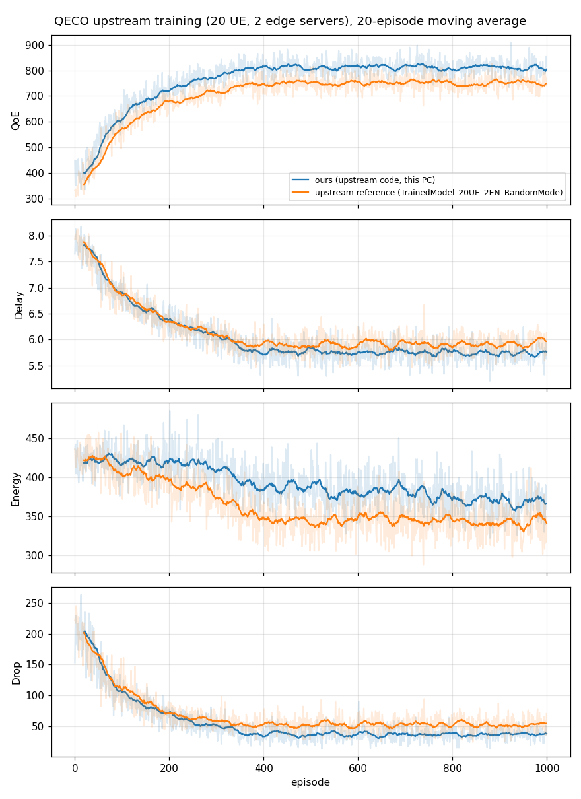

# Phase 2. QECO 원본 재현

## 설정

| 항목 | 값 |
|---|---|
| 코드 | `examples/qeco-fogify/upstream/` (ImanRHT/QECO `9221263`, 수정 없음) |
| 설정 | 원본 `Config.py` 그대로: UE 20대, 엣지 서버 2대, 1000 에피소드, 타임슬롯 0.1초 |
| 실행 환경 | Docker `qeco-tf:0.1` = `tensorflow/tensorflow:2.8.0` + matplotlib, CPU만 사용 |
| 소요 시간 | 약 25분 (분당 약 42 에피소드) |
| 비교 대상 | 원본 저장소의 학습 기록 `TrainedModel_20UE_2EN_RandomMode/` |

**TF 1.15 대신 TF 2.8을 쓴 이유**
- `D3QN.py`는 `import tensorflow.compat.v1 as tf` 다음에 `tf.compat.v1.nn.rnn_cell...`을 부른다 (86줄).
- 이 경로는 TF 2.x에만 있다. TF 1.15에서는 `AttributeError`가 난다.
- 원본 `requirements.txt`도 `tensorflow = 2.8.0`이다.

**원본 코드 대신 실행 래퍼에서 처리한 것** (`run_upstream.py`)
- 원본은 체크포인트를 `models/<episode>/`에 저장하는데, `models/`를 만드는 코드가 주석 처리돼 있다. 래퍼가 실행 폴더에 `models/`를 미리 만든다.
- 에피소드 수만 환경변수 `QECO_EPISODES`로 바꿀 수 있게 했다. 이번에는 원본과 같은 1000으로 실행했다.

## 결과



처음과 마지막 50 에피소드의 평균

| 실행 | 구간 | QoE | Delay (슬롯) | Energy | Drop |
|---|---|---|---|---|---|
| 이번 실행 | 0-49 | 436.1 | 7.67 | 420.6 | 183.8 |
| 이번 실행 | 950-999 | **811.9** | **5.73** | 370.9 | 37.1 |
| 원본 기록 | 0-49 | 393.0 | 7.70 | 424.0 | 182.3 |
| 원본 기록 | 950-999 | **750.4** | **5.97** | 346.8 | 53.7 |

- **완료 기준 통과:** 학습이 끝까지 돌았다. QoE는 약 400에서 약 800으로 오르고, 약 400 에피소드에서 수렴한다.
- **추세가 원본과 같다:** QoE 상승, Delay 감소(7.7 → 약 5.8 슬롯), Drop 감소(약 180 → 약 40~50), 수렴 시점(약 400 에피소드)이 원본 기록과 같다.
- **값이 조금 다르다 (QoE +8%, Energy +7%):** UE마다 에너지 모드(0.25/0.5/0.75)를 실행할 때마다 무작위로 정하고 시드도 고정하지 않기 때문으로 본다.

## 코드를 읽으며 찾은 점 (Phase 3에서 반영)

| 위치 | 내용 |
|---|---|
| `MEC_Env.py` 510줄 | 전송 큐 대기 시간을 `t_ue_tran`이 아니라 `t_ue_comp`에 넣는다. 그래서 `t_ue_tran`은 항상 −1이고, 로컬 연산 큐 값이 덮어써진다 (원본 버그로 보임) |
| `MEC_Env.py` 37줄 | 전송률이 모든 UE와 엣지 서버에서 같은 상수다 (`UE_TRAN_CAP = 14`) |
| 전송 처리 | 전송 시간 = 크기 ÷ 전송률. **RTT 항이 없다** |
| 엣지 서버 처리 | 엣지 서버 연산 능력을 그 엣지 서버를 쓰는 UE 수로 똑같이 나눈다 (`edge_ue_m`) |
| 상태 | [작업 크기, 로컬 큐, 전송 큐, 엣지 서버 큐 ×2, 에너지 모드]. 네트워크 정보(RTT, 대역폭)가 없다 |
| Delay 단위 | 타임슬롯 수(1슬롯 = 0.1초). 실측 TCT(60~270 ms)는 1~3슬롯에 해당한다 |

## 실행 방법

```bash
cd examples/qeco-fogify
docker build -t qeco-tf:0.1 tf
docker run --rm -u 1000:1000 -v $PWD:/w -w /w -e QECO_EPISODES=1000 qeco-tf:0.1 \
    python run_upstream.py results/P2_upstream      # 약 25분
docker run --rm -u 1000:1000 -v $PWD:/w -w /w qeco-tf:0.1 python plot_p2.py
```

결과 파일
- `results/P2_upstream/` (QoE/Delay/Energy/Drop.txt, 원본 그래프)
- `results/P2_upstream_curves.png`
- `results/P2_upstream_summary.csv`
- 체크포인트 `results/P2_upstream/models/`는 용량 때문에 git에서 뺐다.
