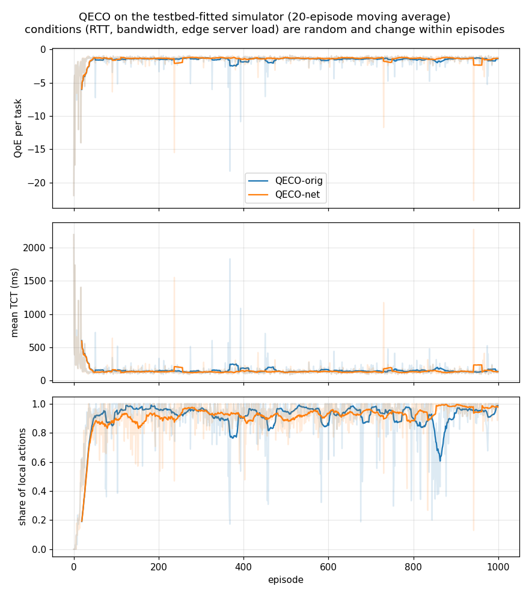
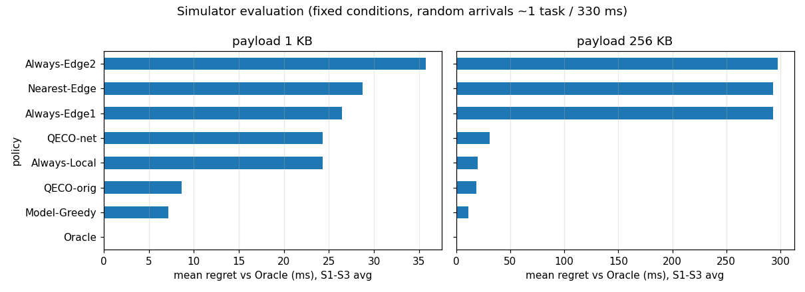

# Phase 3. 시뮬레이터를 테스트베드 조건에 맞추기

원본 `upstream/`은 그대로 두고, 수정본을 `examples/qeco-fogify/qeco_sim/`에 새로 만들었다. 학습 모델(D3QN + LSTM)은 원본 `upstream/D3QN.py`를 **수정 없이** 가져다 쓴다.

## 1. 원본 대비 바꾼 것

| 항목 | 원본 QECO | qeco_sim (테스트베드 맞춤) |
|---|---|---|
| 기기 수 | UE 20대, 엣지 서버 2대 | **로컬 1대**, 엣지 서버 2대 (테스트베드와 같음) |
| 타임슬롯 | 0.1초 | 결정 단위 **10 ms**, 내부 계산 1 ms |
| 로컬 연산 | 일정한 속도 | **CFS 할당량**: 100 ms마다 50 ms (Docker 0.5 CPU) |
| 엣지 서버 연산 | 일정한 속도를 UE 수로 나눔 | 작업당 1코어(엣지 서버당 2코어), 배경 부하 L_i만큼 느려짐 |
| 오프로딩 지연 | 크기 ÷ 전송률 (**RTT 없음**) | **전송(D/B_i) + RTT_i + 엣지 서버 연산** + 0.9 ms |
| 네트워크 | 모든 엣지 서버에 같은 상수 | 엣지 서버마다 RTT_i, B_i, L_i를 따로 두고, 학습 중 무작위로 바뀜 |
| 원본 버그 | `t_ue_tran` 자리에 `t_ue_comp`를 씀 (510줄) | 고침 |
| 보상 | QoE (지연 + 에너지) | **지연만: −TCT / 100 ms** (아래 4절 참고) |

### 테스트베드 값으로 맞춘 상수 (`qeco_sim/testbed_model.py`)

| 상수 | 값 | 근거 (Phase 1, 코어 고정) |
|---|---|---|
| 엣지 서버 연산 (iter 1M) | 67.7 ms | `server_compute_ms` p50 |
| 엣지 서버 추가 지연 | 0.9 ms | TCT 79.0 − 연산 67.7 − ping 10.4 |
| 부하에 따른 엣지 서버 속도 | 1 − 0.566·L | 부하 80%에서 연산 123.7 ms |
| 로컬 연산 (iter 1M) | 70 ms | 로컬 TCT 분포에 맞춤 (아래 2절) |
| 로컬 CPU | 100 ms마다 50 ms | Docker `--cpus 0.5` |
| 작업 크기 | payload 1 / 16 / 64 / 256 KB, iter 1M 고정 | 실험값 |

모델 식이 실측과 맞는지 확인: 엣지 서버 TCT를 RTT 10 ms, 부하 0에서 78.7 ms로 예측했고 실측은 79.0 ms다. 부하 80%에서는 예측 134.7 ms, 실측 134.3 ms다.

## 2. 발견: 로컬 TCT는 작업 도착 간격에 따라 70~180 ms로 바뀐다

CPU 할당량(CFS)은 "100 ms마다 50 ms까지 실행"이다. 그래서 작업 하나(70 ms)가 끝나는 시간은 **작업이 시작될 때 할당량이 얼마나 남았는지**에 따라 달라진다. 테스트베드에서 작업 사이에 쉬는 시간(gap)을 바꿔 가며 측정하고(n = 30) 모델과 비교했다.

| 작업 사이 쉬는 시간 | 실측 로컬 TCT | CFS 모델 |
|---|---|---|
| 0 (연속) | 122 / 177 ms 두 갈래 (p50 147) | 119 / 169 |
| 37 ms | 86 / 140 두 갈래 | 82 / 132 |
| 130 ms | 70 (p95 81) | 70 |
| 300 ms | 99.5 | 99 |
| 370 ms | 70 ~ 123 섞임 | 70 / 106 / 120 |

- **모델이 실측을 거의 그대로 재현한다.** 그래서 시뮬레이터에도 이 모델을 넣었다.
- **로컬 처리가 엣지 서버보다 빠를 수 있다:** 할당량이 남아 있으면 로컬 TCT는 70 ms로, 엣지 서버(RTT 10 ms 기준 79 ms)보다 빠르다.
- **결론:** 로컬↔엣지 서버 break-even은 RTT·대역폭만으로 정해지지 않는다. **로컬의 CPU 할당량 상태(직전 작업 이력)**에 따라 달라진다. RQ1의 상태 변수 후보다.
- 결과 파일: `results/P3_local_gap.csv`

## 3. 타임슬롯 크기 결정: 10 ms

- 실측 TCT는 60~270 ms다. 0.1초 슬롯으로는 1~3칸밖에 안 된다. 그러면 로컬(70~180 ms)과 엣지 서버(79 ms)를 구분하지 못한다.
- 10 ms 슬롯이면 RTT 변화(20 ms 단위)와 CFS 주기(100 ms)를 표현할 수 있다.
- 지연은 슬롯 단위로 반올림하지 않는다. 내부에서 1 ms 단위로 계산하고, 실제 끝나는 시점(소수 ms)까지 기록한다.
- 대가: 에피소드 1개 = 10초 = 1000 슬롯 (원본은 100 슬롯). 학습 시간은 버전당 약 15분이다.

## 4. 학습 설정과 바꾼 이유

| 항목 | 값 |
|---|---|
| 에피소드 | 1000 (10초씩, 작업 도착 확률 0.03/슬롯 → 에피소드당 약 30개) |
| 조건 | 에피소드마다 무작위: RTT 10~250 ms, 대역폭 1/3/10/30/100 Mbit, 부하 0 (40%) 또는 0~0.9. 약 2초마다 하나씩 바뀜 |
| 최대 지연 | 3초 (넘으면 끝내지 못한 작업으로 처리) |
| 하이퍼파라미터 | 원본 `Config.py` 그대로 (lr 0.01, γ 0.9, 메모리 500, 타깃 갱신 200) |
| 학습 시작 | 저장된 전이(transition)가 100개 이상일 때. 원본은 200 step 이후인데, UE가 1대면 그때 전이가 거의 없어서 `learn()`이 에러를 낸다 |

**보상: 원본 QoE → 지연만**
- 에너지 상태를 1로 두면 원본 QoE는 `4·최대지연 − 2·지연`이 된다.
- 이때 로컬과 엣지 서버의 보상 차이는 약 1점인데, Q값은 약 1200이다. 차이가 너무 작아서 두 버전 모두 "항상 로컬"로 굳었다.
- 300 에피소드로 짧게 비교 학습했다 (QECO-net, 시뮬레이터 평가에서 Oracle 대비 평균 손해 ms, 1KB / 256KB).

  | 보상 | γ | 손해 1KB | 손해 256KB |
  |---|---|---|---|
  | QoE (원본) | 0.9 | 35.7 | 20.0 (항상 로컬) |
  | QoE | 0 | 8.8 | 20.0 |
  | **지연만 (−TCT/100ms)** | **0.9** | **8.6** | **11.2** |
  | 지연만 | 0 | 8.0 | 6.0 |

- **결정:** 원본 γ(0.9)를 유지하면서 학습이 되는 "지연만" 보상을 쓴다.

**최고 체크포인트 저장**
- 원본 학습률(0.01)에서는 성능이 오르내린다. 한 번은 1000 에피소드 끝 모델이 다시 "거의 로컬"로 무너졌다.
- 그래서 25 에피소드마다 검증 에피소드 8개(시드 1000~1007, 학습·평가와 다른 시드)로 평균 TCT를 재고, 가장 좋은 모델을 저장한다.

| 버전 | 상태 수 | 최고 시점 | 검증 평균 TCT |
|---|---|---|---|
| QECO-orig | 6 (원본과 같음) | 649 에피소드 | 125.2 ms |
| QECO-net | 6 + RTT_i, B_i, L_i (= 12) | 374 에피소드 | **120.4 ms** |



## 5. 시뮬레이터 안에서 정책 비교 (Phase 5 시나리오와 같은 조건)

조건마다 30초 동안 작업이 무작위로 약 90개 도착한다. 모든 정책이 같은 작업 순서와 같은 CFS 위상을 쓴다. 표의 값은 평균 TCT (ms)다.

**payload 1 KB**

| 조건 | Always-Local | Nearest-Edge | Model-Greedy | QECO-orig | QECO-net | Oracle |
|---|---|---|---|---|---|---|
| RTT 10 | 129 | 79 | **79** | 118 | 93 | 77 |
| RTT 30 | 129 | 99 | 99 | 119 | **97** | 91 |
| RTT 55 | 129 | 123 | 123 | 120 | **102** | 103 |
| RTT 105 | 129 | 173 | 129 | 122 | **113** | 117 |
| RTT 205 | 129 | 273 | 129 | **127** | 129 | 128 |
| BW 1 Mbit | 129 | 87 | **87** | 118 | 98 | 83 |
| Edge1 부하 0.6 (Edge2 RTT 50) | 129 | 114 | 114 | 120 | **103** | 99 |
| Edge1 부하 0.8 (Edge2 RTT 50) | 129 | 136 | 119 | 121 | **107** | 102 |

**전체 평균** (Oracle 대비 손해)

| 정책 | 1 KB | 256 KB |
|---|---|---|
| Always-Local | 129.0 (+35.7) | 129.0 (+20.0) |
| Always-Edge1 / Nearest-Edge | 117.6 (+24.3) | 402.2 (+293.3) |
| Model-Greedy | **100.5 (+7.2)** | **120.5 (+11.5)** |
| QECO-orig | 119.8 (+26.5) | 127.9 (+18.9) |
| QECO-net | 102.0 (+8.7) | 140.1 (+31.1) |
| Oracle | 93.3 | 109.0 |



**해석**
- **QECO-net > QECO-orig (1 KB):** 네트워크·부하 정보를 넣으면 평균 손해가 26.5 → 8.7 ms로 준다. QECO-orig은 조건을 볼 수 없어서 대부분 로컬을 고른다.
- **QECO-net이 Model-Greedy보다 나은 구간:** RTT 55~105 ms와 엣지 서버 부하 0.6~0.8에서 더 낫다. Model-Greedy는 로컬 TCT를 평균식(140 ms)으로 계산하기 때문에, 할당량이 남아 로컬이 빠른 경우(70 ms)를 놓친다. QECO-net은 로컬 큐 상태로 이를 일부 배운다.
- **QECO-net이 약한 곳:**
  - 짧은 RTT(10 ms)에서도 일부 작업을 로컬로 보낸다 (93 vs 79 ms).
  - **256 KB에서는 거의 항상 로컬**을 고른다. 1 Mbit 조건에서는 오히려 엣지 서버로 보내 크게 손해 본다 (262 ms).
  - 대역폭은 상태에 넣었지만, 학습 중 큰 작업이 1/4뿐이라 충분히 배우지 못한 것으로 보인다.
- **Phase 4/5 주의:** 이 결과는 시뮬레이터 안의 값이다. 같은 정책을 Fogify에서 실측했을 때와의 차이를 Phase 5에서 비교한다.

## 6. 완료 기준

- [x] 두 버전 모두 학습이 끝까지 돌았고, 검증 TCT 기준으로 수렴했다.
- [x] 학습된 모델을 저장했다: `results/P3_orig/model/`, `results/P3_net/model/` (각 약 300KB, git에 포함).

## 실행 방법

```bash
cd examples/qeco-fogify
# 학습 (버전당 약 15분, 두 개 동시 실행 가능)
docker run --rm -u 1000:1000 -v $PWD:/w -w /w/qeco_sim qeco-tf:0.1 \
    python train.py --variant net --episodes 1000 --reward delay --out ../results/P3_net
# 그래프와 시뮬레이터 평가
docker run --rm -u 1000:1000 -v $PWD:/w -w /w/qeco_sim qeco-tf:0.1 bash -c "python plot_train.py && python eval_sim.py"
```

| 파일 | 내용 |
|---|---|
| `qeco_sim/testbed_model.py` | 테스트베드 물리 모델 (CFS, RTT, 대역폭, 부하) |
| `qeco_sim/mec_env.py` | 시뮬레이터 환경 |
| `qeco_sim/train.py` | 학습 |
| `qeco_sim/policies.py` | 규칙 기반 정책 (Phase 4에서도 사용) |
| `qeco_sim/qeco_agent.py` | 학습된 모델 불러오기 |
| `qeco_sim/eval_sim.py` | 시뮬레이터 평가 |
| `results/P3_*/train_log.csv`, `val_log.csv`, `meta.json` | 학습 기록 |
| `results/P3_eval_sim.csv` | 평가 결과 |
| `results/P3_tune/` | 보상·γ 비교 학습 기록 |
