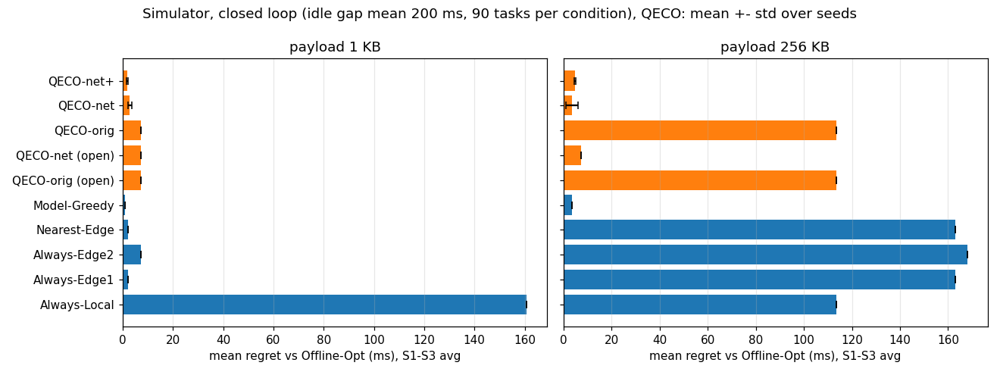

# Phase 3.5. QECO 재학습 (closed-loop, 로컬 0.2 CPU, QECO-net+)

Phase 4.5에서 바로잡은 시뮬레이터로 QECO를 다시 학습했다.
- 작업 도착은 Fogify와 같은 closed-loop이다.
- 엣지 서버 상수는 CPU를 고정한 뒤의 실측값이다.
- 기존 결과(`results/P3_*`)는 그대로 두고, 새 결과는 `results/P35_*`에 저장했다.

## 1. QECO-orig 정의

> **QECO-orig**는 원본 QECO의 상태 6개(작업 크기, 로컬 큐, 전송 큐, 엣지 서버 큐 ×2, 에너지 모드)는 유지했지만, 환경(`qeco_sim`)과 보상(지연만)을 바꿔 다시 학습한 버전이다. 원본 QECO 모델을 그대로 쓴 것이 아니다.

| 이름 | 상태 | 비고 |
|---|---|---|
| QECO-orig | 원본 6개 | 네트워크·엣지 서버 부하 정보 없음 |
| QECO-net | orig + 엣지 서버별 RTT/100, log10(대역폭)/2, CPU 부하 (12개) | LSTM 입력 = 엣지 서버 부하 |
| **QECO-net+** (신규) | net + 로컬 CPU 상태 2개 (14개) | 아래 4절 |
| QECO-orig (open), QECO-net (open) | orig / net과 같음 | **비교군 ①**: open-loop 도착으로 학습 (Phase 3 방식, 물리 상수는 같음) |

## 2. 설정 변경과 그 이유

### 2-1. 로컬 CPU 0.5 → 0.2 (엣지 서버가 약 5배 빠르게)

| | 원본 QECO (`upstream/Config.py`) | Phase 1~4.5 | **Phase 3.5부터** |
|---|---|---|---|
| 로컬 계산 능력 | 2.6 GHz | 0.5 CPU (E코어) | **0.2 CPU** (Fogify `clock_speed: 417`) |
| 엣지 서버 계산 능력 | 42 GHz (20명이 나눠 씀) | 2 CPU, 작업 하나에 1코어 | 같음 |
| 엣지 서버 ÷ 로컬 속도 | 약 16배 | **약 1.3배** (72 vs 평균 96 ms) | **약 4~5배** (72 vs 평균 295 ms, 공식 기준 4.9배) |
| 네트워크 | RTT 없음, 14 Mbps | RTT·대역폭 실제 적용 | 같음 |

**바꾼 이유**
- 엣지 서버가 1.3배밖에 빠르지 않으면 RTT가 약 24 ms만 넘어도 로컬이 이긴다. 오프로딩할 여지가 거의 없다.
- 실제로 스마트폰·IoT 기기와 서버의 계산 능력 차이는 대략 3~10배이다. 그 중간인 약 5배로 맞췄다.
- Fogify는 CPU 할당을 소수 첫째 자리로 반올림한다. 그래서 0.2 CPU(공식 기준 4.9배)가 5배에 가장 가깝다.
- 원본 QECO의 16배는 RTT 0과 함께, 엣지 서버가 압도적으로 유리하다고 가정한 설정이다. 우리 연구는 네트워크 상태 때문에 결정이 바뀌는 상황을 보는 것이므로 그 가정을 따르지 않는다.
- 결과적으로 로컬과 엣지 서버의 손익분기 RTT가 약 24 ms에서 **약 200 ms**로 옮겨 갔다. S1(RTT 10~205)의 마지막 조건에서 결정이 갈린다.

**실측 보정** (`phase35_calib.py` → `P35_calib.csv`, n = 30 × 2라운드)

| | Fogify | 시뮬레이터 |
|---|---|---|
| 로컬, 연속 실행 | 310 / 390 ms 두 무리 | 310 / 390 ms |
| 로컬, closed-loop 평균 (5~95%) | 295 ms (232~368) | 280 ms (230~329) |
| 엣지 서버 연산 | 72.1 ms | 72.1 ms |

`LOCAL_WORK_MS = 70`은 그대로 맞는다. 바꾼 것은 `LOCAL_QUOTA_MS`(50 → 20)뿐이다.

### 2-2. 사용자 수는 1명 그대로

- 원본 QECO는 20명이 엣지 서버 2대를 나눠 쓴다. 다른 사용자 때문에 엣지 서버가 붐비는 상황을 배우는 것이 핵심이다.
- 우리는 사용자 1명이고, **엣지 서버 CPU 부하(stress)가 다른 사용자들의 작업을 대신한다.** 학습 중 부하 L_i는 0~90%로 바뀌고, Phase 5 S3에서는 30/60/80%이다.
- 여러 사용자가 동시에 오프로딩하는 상황(로컬 컨테이너 여러 개)은 단일 PC의 남은 코어로는 3~4개까지 가능하다. 다만 드라이버를 크게 바꿔야 해서 한계로 남긴다.

### 2-3. 학습 조건

| 항목 | Phase 3 | Phase 3.5 | 이유 |
|---|---|---|---|
| 작업 도착 | open-loop | **closed-loop** (평균 200 ms 쉼) | Fogify 드라이버와 같게 (Phase 4.5) |
| 작업 크기 분포 (1/16/64/256 KB) | 각 25% | **20 / 20 / 30 / 30%** (큰 작업 60%) | 큰 작업 학습 보강 |
| RTT 분포 | 균등 10~250 ms | **로그 균등 5~250 ms** | 아래 3절 |
| γ | 0.9 | **0** | 아래 3절 |
| 보상 | −TCT/100 ms | 같음 | |
| 에피소드 | 1000 | 약 750에서 멈춤 | 검증 성능 정체. 최고 체크포인트(검증 기준)를 사용 |

**상태 정규화 확인**
- 대역폭은 log10(Mbit)/2라서 1~100 Mbit이 0~1로 들어간다. 따로 고칠 필요가 없었다.
- 작업 크기는 KB/64(0.016~4)로 이미 상태에 들어 있다.

## 3. 학습이 실패한 시도와 고친 것 (숨기지 않고 기록)

| 시도 | 설정 | 결과 | 보관 |
|---|---|---|---|
| a | 로컬 0.5 CPU, RTT 균등 10~250, γ 0.9, 3종 × 시드 3 | **9개 모두 "항상 로컬"로 수렴** (로컬 선택 96~99%, 검증 TCT가 모두 Always-Local과 같은 95.5 ms) | `results/P35a_*` |
| 원인 | 엣지 서버가 이기는 경우(RTT < 24 ms)가 학습 상황의 6%뿐이었다. 그 분포에서는 "항상 로컬"이 거의 정답이다 | | |
| 조치 | RTT를 로그 균등 5~250 ms로 바꿨다 (엣지 서버가 이길 수 있는 상황이 많아지도록). 로컬은 0.2 CPU로 바꿨다 (2-1절) | | |

**γ 짧은 시험** (400 에피소드, 시드 0, closed-loop 시뮬레이터에서 S1~S3 평균 손해 ms)

| | 1KB | 256KB |
|---|---|---|
| net, γ 0.9 | 7.1 | 9.7 |
| net, γ 0 | **3.8** | **8.2** |
| net+, γ 0.9 | 1.5 | 6.4 |
| net+, γ 0 | 2.0 | **3.1** |

γ 0을 골랐다. closed-loop에서는 작업이 서로 독립이라 다음 작업의 보상까지 볼 필요가 거의 없다. 결과도 전체적으로 낫다 (`results/P35_tune/`).

## 4. QECO-net+: 로컬 CPU 상태

| 추가 상태 | 정규화 | 테스트베드에서 읽는 법 |
|---|---|---|
| 직전 로컬 작업이 끝난 뒤 지난 시간 | ÷1000 ms, 1로 자름 | 드라이버가 로컬 작업 종료 시각을 기록 (`Testbed.last_local_end`) |
| 그 로컬 작업의 TCT | ÷200 ms | 드라이버가 agent 응답의 `tct_ms`를 기록 (`Testbed.last_local_tct`) |

**왜 이 두 값인가**
- closed-loop에서는 로컬 큐가 늘 0이다. 그래서 로컬 작업이 빨리 끝날지(CFS 할당량이 남아 있음) 늦게 끝날지는 할당량·주기 상태에 달려 있다.
- 직전 로컬 작업의 종료 시각과 TCT가 그 상태를 간접적으로 알려 준다.

**검토했지만 쓰지 않은 것**
- 현재 CFS 주기에서 남은 할당량: 로컬 컨테이너의 cgroup `cpu.stat`에는 누적값(`nr_periods`, `nr_throttled`, `throttled_usec`)만 있다. 현재 주기에서 남은 할당량은 직접 읽을 수 없다.
- 그래서 드라이버가 직접 아는 두 값만 썼다. 시뮬레이터와 드라이버는 같은 함수(`mec_env.local_features`)를 쓴다.

## 5. 결과 (시뮬레이터, closed-loop)

- 조건: Phase 3와 같은 S1~S3 조건, 조건마다 90개 작업, 1KB / 256KB.
- 손해 = 정책 평균 TCT − 사후 최적(Offline-Opt) 평균 TCT. QECO는 시드 3개의 평균 ± 표준편차이다.
- 파일: `phase35_eval.py` → `P35_eval_sim.csv`, `P35_eval_per_seed.csv`, `P35_eval_summary.csv`, `P35_eval_sim.png`

| 정책 | 1KB 손해 (ms) | 256KB 손해 (ms) |
|---|---|---|
| Model-Greedy | 1.0 | 3.6 |
| **QECO-net+** | **1.9 ± 0.3** | 4.8 ± 0.2 |
| **QECO-net** | 2.8 ± 0.8 | **3.5 ± 2.5** |
| Always-Edge1 / Nearest-Edge | 2.0 | 163.0 |
| Always-Edge2 | 7.1 | 168.0 |
| QECO-orig | 7.1 ± 0.0 | 113.4 ± 0.0 |
| QECO-net (open) ① | 7.1 | 7.2 |
| QECO-orig (open) ① | 7.1 | 113.4 |
| Always-Local | 160.8 | 113.4 |



**완료 기준 확인**
- 256KB에서 QECO-net의 손해(3.5)가 Always-Local(113.4)보다 작다. **통과.**
- Phase 3의 QECO-net은 31.1이었고 Always-Local 20.0보다 나빴다.

**결과 정리**
- **QECO-net, QECO-net+는 학습이 됐다.** 시드 3개 모두 무너지지 않았고(한 가지 행동만 고른 시드 없음), 손해가 Model-Greedy와 1~2 ms 차이이다.
- **QECO-orig는 작업 크기만 보는 고정 규칙이 됐다.** 시드 3개가 모두 같다.
  - 1KB는 항상 엣지 서버 2, 256KB는 항상 로컬이다.
  - 네트워크 정보가 없으니 RTT·대역폭·부하가 바뀌어도 따라갈 수 없다. 원본 QECO 상태의 한계이다.
- **open-loop로 학습한 비교군 ①은 closed-loop 평가에서 손해가 2~4배 크다** (net: 7.1 / 7.2 vs 2.8 / 3.5).
  - QECO-net (open)은 S3에서 엣지 서버 1의 부하를 보지 않고 항상 엣지 서버 2를 골랐다 (부하 0%일 때 손해 40 ms).
- **QECO-net+(로컬 CPU 상태)의 효과는 섞여 있다.**
  - 1KB에서는 1.9 vs 2.8로 조금 낫다. S3의 부하 30~60% 구간이 특히 낫다 (0 / 2.3 vs 8.8 / 4.5).
  - 256KB에서는 4.8 vs 3.5로 조금 나쁘다.
  - 손익분기 근처(RTT 205)에서는 1KB 12.6 vs 12.6으로 차이가 없고, 256KB는 17.8 vs 11.7로 오히려 나쁘다.
  - 즉, **로컬 CPU 상태가 결정을 뚜렷하게 개선한다는 증거는 시뮬레이터에서 나오지 않았다.**

**RTT 205 ms (로컬과 엣지 서버가 비슷한 구간)**
- 원래 계획은 RTT 55~105에서 net과 net+를 비교하는 것이었다. 로컬을 0.2 CPU로 바꾸면서 그 구간은 엣지 서버가 확실히 이기는 구간이 됐다 (모든 학습 정책 손해 0).
- 그래서 손익분기 구간인 RTT 205로 대신 봤다.

| RTT 205 | Always-Local | Always-Edge | Model-Greedy | QECO-net | QECO-net+ |
|---|---|---|---|---|---|
| 1KB 손해 | 14.4 | 11.7 | 11.7 | 12.6 | 12.6 |
| 256KB 손해 | 5.6 | 23.9 | 23.9 | 11.7 | 17.8 |

- 이 구간에서 사후 최적은 작업마다 로컬이 빨리 끝나는 경우를 골라낸다. 어떤 정책도 그 이득을 못 가져간다.

**⚠ 주의**
- 시뮬레이터 안에서는 Model-Greedy가 유리하다. Model-Greedy의 엣지 서버 TCT 식이 시뮬레이터 식과 같기 때문이다.
- 최종 비교는 Phase 5(Fogify 실측)에서 한다.

## 6. Phase 5에서 쓸 모델

시드는 **검증 TCT 기준**으로 골랐다. 평가 결과를 보고 고르지 않았다.

| 정책 | 모델 | 최고 체크포인트 (에피소드) | 검증 TCT (ms) |
|---|---|---|---|
| QECO-orig | `P35_orig_s0` | 599 | 199.0 (시드 3개 동일) |
| QECO-net | `P35_net_s0` | 424 | 160.6 |
| QECO-net+ | `P35_netplus_s0` | 499 | 162.1 |
| QECO-orig (open) ① | `P35_open_orig` | 699 | 270.6 (open-loop 검증) |
| QECO-net (open) ① | `P35_open_net` | 124 | 234.1 (open-loop 검증) |

## 재현

```sh
cd examples/qeco-fogify
sudo sh host/cpu_perf.sh on                        # CPU 고정 (재부팅하면 풀림)
docker exec -w /home/jovyan/examples/qeco-fogify fogemulator-ui-1 python phase35_calib.py
GAMMA=0 sh qeco_sim/run_p35.sh                     # 9개 병렬 학습
for v in orig net; do                               # 비교군 ①
  docker run --rm -u 1000:1000 -v $PWD:/w -w /w/qeco_sim qeco-tf:0.1 python train.py --variant $v \
    --episodes 1000 --arrival open --reward delay --gamma 0.9 --out ../results/P35_open_$v; done
docker run --rm -u 1000:1000 -v $PWD:/w -w /w/qeco_sim qeco-tf:0.1 python phase35_eval.py
```
