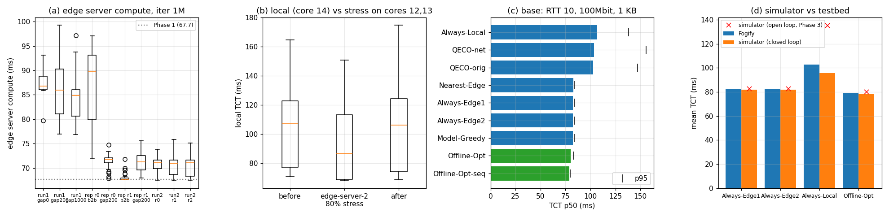

# Phase 4.5. 평가 방식 바로잡기 (재학습 전)

Phase 4에서 드러난 두 문제를 고친다.
1. 사후 최적(Offline-Opt) 측정 방식이 실제 정책과 다르다.
2. 학습(시뮬레이터)과 평가(Fogify)의 작업 도착 방식이 다르다.

이 Phase에서는 재학습하지 않는다. 기존 결과(`results/P4_*`, `results/P3_*`)는 그대로 두고, 새 결과는 `results/P45_*`에 저장했다.

## 용어: Oracle → 사후 최적 (Offline-Opt)

> 사후 최적(Offline-Opt)은 각 작업을 로컬, 엣지 서버 1, 엣지 서버 2에서 모두 실측한 뒤 가장 짧은 TCT를 선택한 이상적 기준이다. 정책이 도달할 수 있는 TCT의 실측 하한을 나타낸다.

- 표와 그래프에서는 **Offline-Opt**로 쓰고, 정책 성능은 **사후 최적 대비 손해(regret, ms)**로 나타낸다.
- Phase 3·4 문서의 "Oracle" 표기도 모두 바꿨다.
- 새 결과 CSV의 정책 이름도 `Offline-Opt`이다. Phase 4 방식은 `Offline-Opt-seq`로 남겼다.

## 바꾼 것

| # | 바꾼 것 | 이유 | 파일 |
|---|---|---|---|
| 1 | Offline-Opt를 같은 시드로 따로 돌린 Always-Local / Edge1 / Edge2 결과에서 **작업마다 최솟값**으로 계산 | Phase 4 방식은 한 작업을 세 위치에서 연달아 실행했다. 그러면 실제 정책과 실행 조건이 달라진다 (아래 결과 1) | `driver.offline_opt()` |
| 2 | 시뮬레이터에 **closed-loop 도착** 추가 (`arrival="closed"`). 이전 작업이 끝나고 쉬는 간격(평균 200 ms, 지수분포)이 지난 뒤 다음 작업 1개 | Fogify 드라이버와 같은 방식. 기존 open-loop는 `arrival="open"`(기본값)으로 남겼다 | `qeco_sim/mec_env.py` |
| 2 | 쉬는 간격 생성 함수를 시뮬레이터와 드라이버가 함께 쓰게 함 | 같은 시드면 같은 간격 순서 | `qeco_sim/arrivals.py` |
| 2 | `train.py --arrival open\|closed`, `eval_sim.py --arrival closed --out ...` | Phase 3.5 재학습용. P3 모델(`results/P3_orig`, `P3_net`)은 open-loop 학습으로 그대로 보관한다 (학습·평가 불일치 비교군) | `qeco_sim/train.py`, `eval_sim.py` |
| 3 | 엣지 서버 상수: 연산 67.7 → **71.3 ms**, 추가 지연 0.9 → **0.4 ms**, 부하 계수 다시 맞춤 | 아래 결과 2 | `qeco_sim/testbed_model.py` |
| 3 | 정책 결정 시간은 TCT에 **포함하지 않음**. `decide_ms` 열에 따로 기록 | TCT는 로컬 agent 안에서 작업 시작부터 끝까지 잰다. 정책 결정은 그 전에 끝난다 | `driver.py` |

결정 시간 p50은 규칙 기반 1.4~1.5 ms, QECO 6.8~7.2 ms이다 (정책 서버 HTTP 왕복 포함). QECO를 실제로 쓰면 이만큼 TCT가 늘어난다. Phase 5 표에는 별도 열로 넣는다.

## 실험

Fogify 기본 조건: RTT 10 ms, 100Mbit, 부하 0, iter 1M, 1KB.

| 파일 | 내용 |
|---|---|
| `phase45_testbed.py` → `P45_testbed.csv` | 1차 실행: gap 테스트, 코어 묶음 공유, 기본 조건 (정책마다 30개를 이어서 실행) |
| `phase45_repeat.py` → `P45_repeat_r1.csv` | 재현 확인: Phase 1 방식(`uvc-client run`, 연속 실행)과 agent(쉬는 간격 200 ms)를 같은 배포에서 2번씩 |
| `phase45_testbed2.py` → `P45_testbed2.csv`, `P45_base_summary.csv` | **본 결과.** 정책을 섞어 실행: 정책마다 10개씩 3라운드. 코어 묶음 공유는 부하 전/중/후 × 2라운드 |
| `qeco_sim/phase45_sim.py` → `P45_sim_check.csv` | 시뮬레이터 (open / closed, 시드 5개) vs Fogify |
| `plot_p45.py` → `P45_testbed.png` | 그림 |

## 결과 1. 기존 Offline-Opt vs 새 Offline-Opt

본 결과(`P45_testbed2`), n = 30.

| | 평균 TCT | p50 | p95 | 로컬 / E1 / E2 선택 비율 |
|---|---|---|---|---|
| 새 방식 (Always-* 따로 실행, 작업마다 최솟값) | **78.8** | 80.4 | 83.0 | .33 / .30 / .37 |
| 기존 방식 (한 작업을 세 위치에서 연달아) | 77.7 | 78.7 | 80.0 | .20 / .33 / .47 |
| (참고) Phase 4 기존 방식 | 75.2 | 78.0 | 79.3 | .50 / .23 / .27 |
| (참고) 1차 실행 (느린 구간) 새 방식 / 기존 방식 | 85.5 / 85.8 | | | .33 / .40 (로컬) |

**기존 방식의 왜곡은 예상과 반대로 엣지 서버 쪽에서 컸다.**

| 기존 방식 안에서 잰 TCT | 기존 방식 | 따로 실행 | 차이 |
|---|---|---|---|
| 로컬 (평균) | 100.8 | 100.3 (Always-Local) | 거의 없음 |
| 엣지 서버 (p50) | 79.0 | 82.7 (Always-Edge) | **−3.7 ms** |

- 기존 방식에서는 엣지 서버 실행이 로컬 실행 바로 뒤에 쉬지 않고 이어진다. 그래서 엣지 서버 코어가 덜 식은 상태에서 연산한다 (연산 67.7 vs 71.2 ms, 결과 2).
- 걱정했던 로컬 할당량 회복 효과는 이번 측정에서 보이지 않았다.
- 결과적으로 기존 방식은 하한을 약 1 ms 낮게 잡는다. 로컬 선택 비율은 실행마다 20~50%로 흔들린다.
- 앞으로는 새 방식만 쓴다.

## 결과 2. 엣지 서버 TCT가 늘어난 원인 (79.0 → 82.6 ms)

**agent 오버헤드가 아니었다.** 엣지 서버 TCT를 나눠 보면 아래와 같다 (본 결과, p50).

| 구성 | ms |
|---|---|
| TCT | 82.7 |
| 엣지 서버 연산 (`server_compute_ms`) | 71.2 |
| RTT (agent `/probe` 관측) | 10.5 |
| 나머지 (HTTP 처리 등) | 0.3~0.5 |

늘어난 것은 **연산 시간**이다. 작업 사이에 쉬는 시간이 있으면 E코어가 느려진다.

| 측정 (같은 배포, 재현 확인 `P45_repeat_r1`) | 연산 p50 (ms) |
|---|---|
| 연속 실행 (Phase 1 방식) | 67.7 |
| 쉬는 간격 200 ms (agent) | 71.3 / 71.7 |
| 기존 Offline-Opt 안의 엣지 서버 실행 (로컬 실행 직후) | 67.7 |

Phase 1의 "추가 지연 0.9 ms"는 ping으로 잰 RTT를 기준으로 계산한 값이었다. agent가 관측하는 RTT(`/probe`)를 기준으로 하면 0.4 ms이다.

**시뮬레이터 상수 변경**

| 상수 | 이전 | 변경 |
|---|---|---|
| `EDGE_WORK_MS` | 67.7 | **71.3** (closed-loop은 늘 쉬는 간격 뒤에 실행) |
| `EDGE_OVERHEAD_MS` | 0.9 | **0.4** |
| `STRESS_ALPHA` | 0.566 | 0.53 (부하 80%일 때 연산 123.7 ms는 그대로 맞춤) |
| `EDGE_WORK_B2B_MS` | - | 67.7 (참고용) |

**⚠ 측정 구간에 따라 엣지 서버 연산이 크게 느려지는 일이 있다.**
- 1차 실행 전체와 재현 확인의 첫 블록에서 같은 작업의 연산이 80~90 ms였다 (그림 (a)).
- 같은 배포 안에서도 몇 분 뒤에는 67.7 / 71 ms로 돌아왔다.
- 호스트에 다른 부하는 없었고 전원도 연결되어 있었다. CPU 주파수 정책은 `powersave` + `balance_performance`, 플랫폼 프로필은 `balanced`이다.
- 원인은 E코어 클러스터의 주파수 변화로 추정하지만 확인하지 못했다.

**대응 (Phase 5부터)**
- 정책을 이어서 실행하지 않고 **라운드로 섞어 실행**한다. 그러면 느린 구간이 모든 정책에 고르게 걸린다.
- 모든 작업에 `server_compute_ms`를 기록해서 느린 구간을 찾아낼 수 있게 한다.
- 1차 실행의 기본 조건 표(`P45_testbed_summary.csv`)는 느린 구간에 걸려 있어 참고용으로만 쓴다.
- 주파수를 고정하려면(`performance` 거버너) sudo가 필요하다. 아직 바꾸지 않았다.

## 결과 3. 로컬과 엣지 서버 2의 코어 묶음 공유

- 로컬은 코어 14, 엣지 서버 2는 코어 12·13이다. 둘 다 E코어 묶음 B에 있다.
- 엣지 서버 2에 CPU 80% 부하를 건 동안 로컬 TCT를 쟀다 (Always-Local, 쉬는 간격 200 ms, n = 30).
- 관측된 엣지 서버 2 부하는 0.79~0.80이었다.

| 실행 | 부하 전 평균 | 부하 중 | 부하 후 | 부하 중 / 전 | Mann-Whitney p |
|---|---|---|---|---|---|
| 본 결과 1라운드 | 109.5 | 96.9 | 107.0 | **−11.5%** | 0.02 |
| 본 결과 2라운드 | 97.6 | 88.2 | 100.5 | **−9.7%** | 0.03 |
| 1차 실행 (느린 구간) | 111.2 | 121.7 | - | **+9.5%** | 0.05 |

- **기준 5%를 넘는다.** 묶음 B의 다른 코어가 바쁠 때 로컬이 오히려 약 10% 빨라졌다. 부하가 끝나면 원래대로 돌아왔다.
- 묶음 전체의 클럭이 같이 오르는 효과로 보인다. 느린 구간에서는 반대로 10% 느려졌다.
- 즉, 엣지 서버 2에 부하를 걸면 로컬 TCT도 같이 바뀐다.

**영향 범위**
- 우리 작업끼리는 문제가 없다. 작업을 하나씩 실행하므로(closed-loop) 로컬과 엣지 서버 2가 동시에 계산하는 일이 없다.
- 문제는 엣지 서버 2에 **배경 부하**를 걸 때뿐이다.
- Phase 5 S3은 엣지 서버 1(묶음 A)에만 부하를 건다.

**제안 (선택 필요)**

| 안 | 내용 | 장점 | 단점 |
|---|---|---|---|
| **A (추천)** | 코어 배치는 그대로 두고, Phase 5의 배경 부하(S3, S4)는 **엣지 서버 1에만** 건다 | 지금까지의 로컬 보정(CFS 모델, LOCAL_WORK 70 ms)을 그대로 쓴다 | S4에서 엣지 서버 2 부하 변화는 다루지 못한다 |
| B | 로컬을 P코어 하나로 옮긴다 (예: CPU 7, 짝 스레드 6은 비움) | 엣지 서버 둘 다 부하를 걸 수 있다 | P코어는 E코어보다 빨라서 로컬 연산 시간을 다시 재고 시뮬레이터도 다시 맞춰야 한다. P코어는 Fogify와 호스트가 쓰고 있다 |

## 결과 4. 시뮬레이터 vs Fogify (기본 조건)

시뮬레이터는 시드 5개 평균이고, Fogify는 본 결과(n = 30)이다.

| 정책 | Fogify 평균 / p50 / p95 | 시뮬레이터 closed-loop | 시뮬레이터 open-loop (Phase 3 방식) |
|---|---|---|---|
| Always-Local | **102.6** / 106.6 / 138.3 | **95.8** / 93.6 / 126.4 | 135.1 / - / 281.2 |
| Always-Edge1 | 82.2 / 82.7 / 84.4 | 81.9 / 82.0 / 82.0 | 82.5 / - / 88.9 |
| Offline-Opt | 78.8 / 80.4 / 83.0 | 78.2 / 81.9 / 82.0 | 80.1 / - / 83.7 |

- closed-loop로 바꾸니 Always-Local 평균이 실측과 7% 안으로 들어왔다. open-loop는 +32%였다. Phase 4 실측 100.2와 비교하면 차이는 4%이다.
- open-loop에서는 작업이 겹쳐 로컬 큐가 쌓이므로 로컬이 실제보다 훨씬 느리게 보였다. QECO가 "큐가 차면 엣지 서버"를 배운 것도 이 때문이다.
- 엣지 서버는 상수를 고친 뒤 0.3 ms 차이로 맞는다.

## 결과 5. 기본 조건, 모든 정책 (본 결과, 섞어 실행, n = 30)

| 정책 | p50 | p95 | 평균 | 손해 (평균 − Offline-Opt) | 로컬 / E1 / E2 | 결정 시간 p50 |
|---|---|---|---|---|---|---|
| Offline-Opt | 80.4 | 83.0 | **78.8** | 0 | .33 / .30 / .37 | - |
| Model-Greedy | 82.5 | 83.9 | 82.1 | +3.2 | 0 / 0 / 1 | 1.4 |
| Nearest-Edge | 82.8 | 83.9 | 82.1 | +3.3 | 0 / .27 / .73 | 1.5 |
| Always-Edge1 | 82.7 | 84.4 | 82.2 | +3.4 | | 1.5 |
| Always-Edge2 | 82.7 | 84.4 | 82.4 | +3.5 | | 1.4 |
| QECO-orig (P3 모델) | 102.6 | 147.0 | 100.9 | +22.0 | 1 / 0 / 0 | 7.2 |
| Always-Local | 106.6 | 138.3 | 102.6 | +23.7 | | 1.5 |
| QECO-net (P3 모델) | 103.5 | 155.7 | 103.3 | +24.4 | 1 / 0 / 0 | 6.8 |

- 오류 0건. 라운드별 엣지 서버 연산 p50은 71.2 / 70.8 / 70.7 ms로 느린 구간이 없었다.
- QECO 두 버전은 재학습 전이라 여전히 항상 로컬을 고른다 (예상한 결과).
- 이 기본 조건에서 Offline-Opt는 엣지 서버 고정보다 3.4 ms 빠르다. 로컬이 70 ms 근처로 끝나는 작업이 3분의 1 있기 때문이다.
- **이 3 ms가 학습 정책이 기본 조건에서 노릴 수 있는 최대 이득이다.**

## Phase 3.5로 넘길 것

- 재학습은 `train.py --arrival closed`로 한다. 바뀐 상수(71.3 / 0.4 ms)가 자동으로 적용된다.
- QECO-net+ 후보 상태
  - closed-loop에서는 로컬 큐가 늘 0이다. 그래서 로컬이 70 ms로 끝날지 120 ms 이상 걸릴지는 **직전 로컬 작업 이후 지난 시간**(CFS 할당량 회복)으로만 알 수 있다.
  - 드라이버는 이 값을 직접 안다 (마지막 로컬 작업 종료 시각).
- 결정 필요: 결과 3의 코어 배치 안 A / B.
