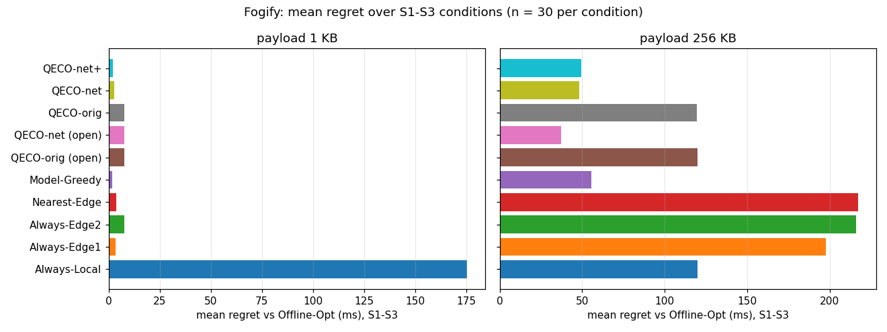
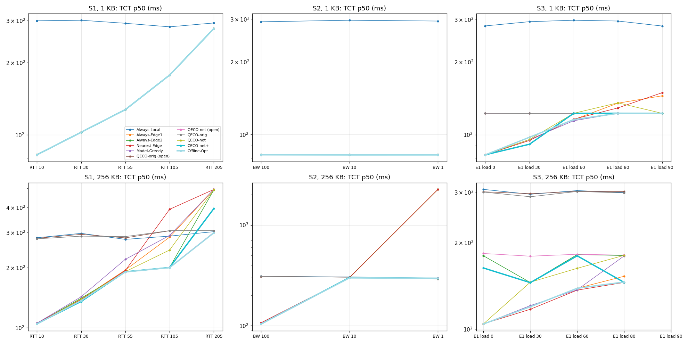
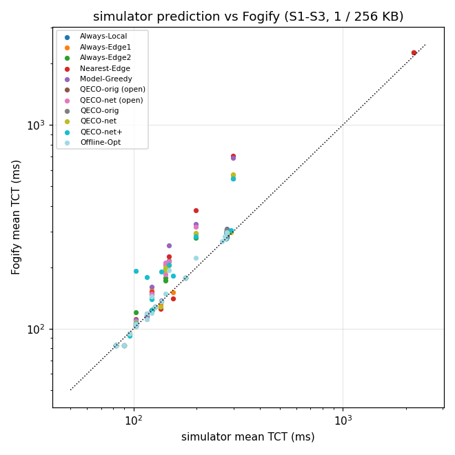
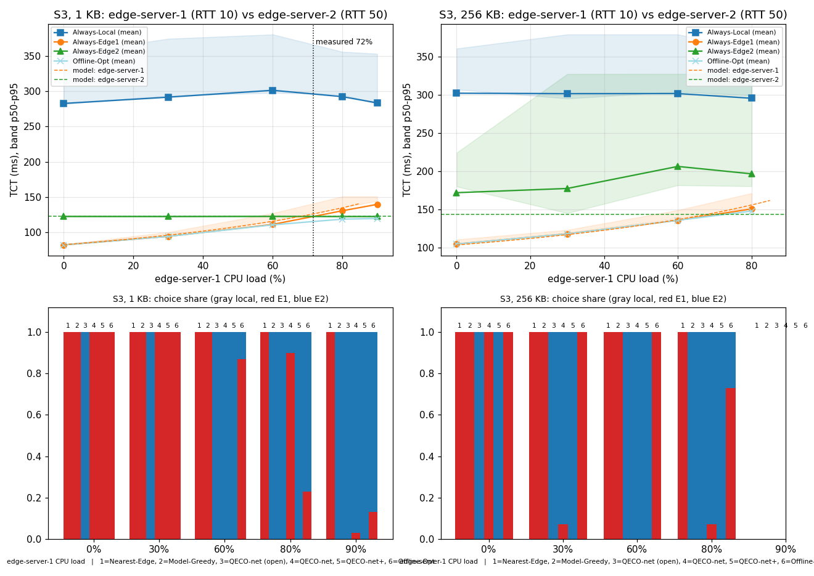
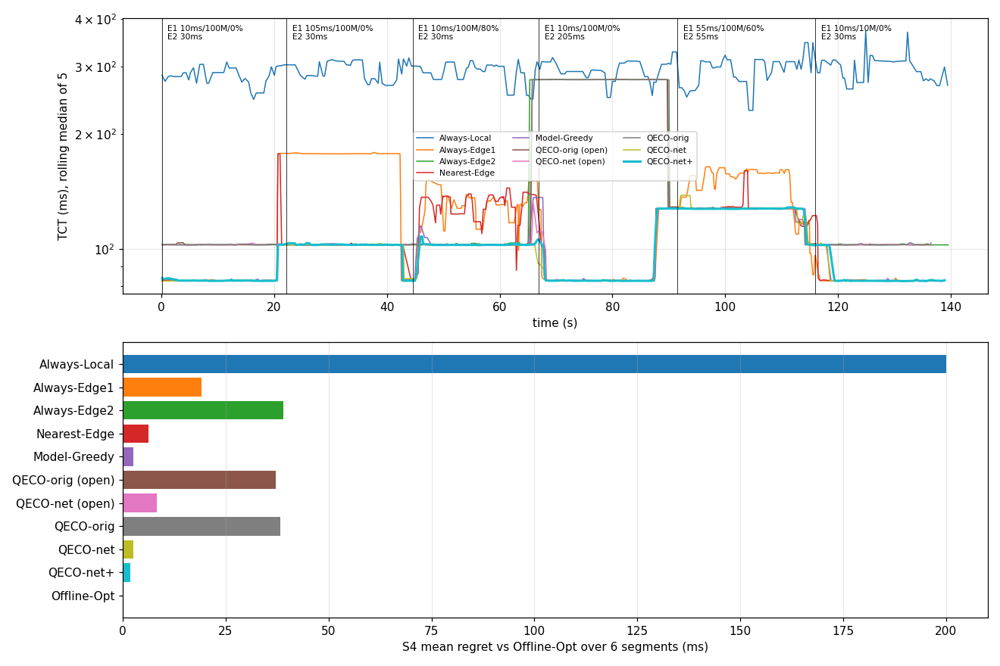
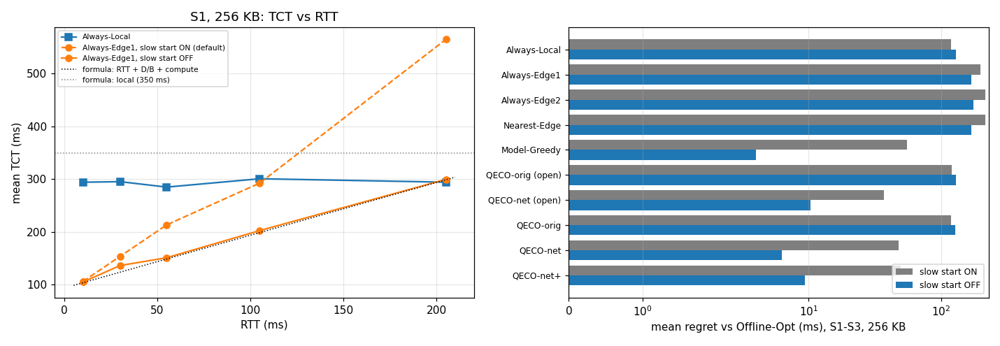

# Phase 5. Fogify 비교 실험 (S1~S4)

학습한 QECO와 규칙 기반 정책을 **실제 Fogify 테스트베드**에서 같은 조건으로 비교했다.

## 요약

1. **1KB(작은 작업)에서는 네트워크·부하를 보는 정책이 사후 최적에 2~3 ms 차이로 가깝다.**
   - 해당 정책: QECO-net 2.7, QECO-net+ 2.1, Model-Greedy 1.6 ms.
   - 동적 시나리오 S4에서는 **QECO-net+가 손해 1.9 ms로 가장 좋았다** (QECO-net 2.6, Model-Greedy 2.6, Nearest-Edge 6.3).
2. **256KB(큰 작업)에서는 모든 정책이 시뮬레이터 예측보다 크게 손해 봤다. 원인은 TCP slow start로 확인됐다 (결과 6).**
   - RTT가 클수록 엣지 서버 TCT가 예측보다 훨씬 길었다. 예: RTT 205에서 예측 298 ms, 실측 p50 493 / p95 1103 ms.
   - 작업 사이에 쉬면 혼잡 윈도우가 처음으로 돌아가서, 256KB를 보내려면 RTT를 1~4번 더 왕복해야 한다.
   - 컨테이너에서 `tcp_slow_start_after_idle = 0`으로 끄고 다시 재 보니 다음과 같았다.
     - 엣지 서버 TCT가 식과 1~3 ms 안으로 맞았다 (RTT 205: 299 vs 298 ms).
     - 정책 손해가 Model-Greedy 55.6 → 4.0, QECO-net 48.1 → 6.3 ms로 줄었다.
   - 시뮬레이터(그리고 Model-Greedy의 식)는 전송 시간을 크기 ÷ 대역폭으로만 계산해서 이를 놓쳤다. **RQ1에 대한 중요한 실측 결과**이다.
3. **S3 역전 지점:** 1KB에서 "가깝지만 바쁜 엣지 서버 1"이 "멀지만 한가한 엣지 서버 2"보다 느려지는 부하는 **실측 약 72%, 모델 예측 68%**이다 (RQ2).
   - 부하 90%에서는 RTT만 보는 **Nearest-Edge의 손해가 27.1 ms**이다. 부하를 보는 정책은 3.0~3.6 ms이다.
4. **학습·평가 조건 불일치**(비교군 ①, open-loop로 학습)와 **원본 상태만 쓰는 QECO-orig**는 네트워크·부하 변화를 따라가지 못했다.
   - 두 정책은 사실상 "작업 크기만 보는 고정 규칙"이 됐다.
   - 1KB 손해: 7.5 ms (QECO-net 2.7). S4 손해: 37~38 ms (QECO-net 2.6).
5. **로컬 CPU 상태(QECO-net+)의 효과는 작다.**
   - 1KB S1~S3에서는 2.1 vs 2.7 ms, S4에서는 1.9 vs 2.6 ms로 조금 낫다.
   - 256KB에서는 slow start를 켰을 때 49.5 vs 48.1, 껐을 때 9.4 vs 6.3 ms로 오히려 조금 나쁘다.

## 설계

| 항목 | 값 |
|---|---|
| 테스트베드 | 로컬 0.2 CPU (코어 14), 엣지 서버 1·2 각 2 CPU (코어 8·9 / 12·13). CPU 고정 (`host/cpu_perf.sh on`) |
| 작업 | SHA-256 iter 1M, payload 1KB / 256KB. closed-loop (앞 작업이 끝나고 평균 200 ms 쉰 뒤 다음 작업) |
| 반복 | 조건 × 정책마다 n = 30. **10개씩 3라운드로 섞어 실행**하고 라운드마다 정책 순서를 돌렸다 |
| 사후 최적 (Offline-Opt) | 같은 작업 순서(시드)로 따로 실행한 Always-Local / Edge1 / Edge2 결과에서 작업마다 최솟값 (Phase 4.5) |
| 손해 (regret) | 정책 평균 TCT − 같은 조건의 Offline-Opt 평균 TCT. 따로 실행한 결과끼리 비교하므로 잡음 때문에 조금 음수가 될 수 있다 |
| 배경 부하 | 엣지 서버 1에만 건다 (Phase 4.5 안 A) |

**시나리오**

| | 엣지 서버 1 | 엣지 서버 2 | RQ |
|---|---|---|---|
| S1 | RTT 10 / 30 / 55 / 105 / 205, 100Mbit | 엣지 서버 1과 같음 | RQ1 (RTT 손익분기) |
| S2 | RTT 10, 100 / 10 / 1 Mbit | 엣지 서버 1과 같음 | RQ1 (대역폭) |
| S3 | RTT 10, 부하 0 / 30 / 60 / 80% (+ 90%, 1KB만) | RTT 50, 부하 0 | RQ2 (가깝고 바쁨 vs 멀고 한가함) |
| S4 | 6개 구간 × 약 22초, 실행 중에 조건이 바뀜 (아래 표) | | 동적 변화 |

**정책** (규칙 5개, 학습 5개, 계산으로 구하는 Offline-Opt)

| 정책 | 내용 | 비교군 |
|---|---|---|
| Always-Local / Always-Edge1 / Always-Edge2 | 고정 | |
| Nearest-Edge | RTT가 가장 작은 엣지 서버 | |
| Model-Greedy | 식으로 TCT를 예측해서 가장 작은 곳. 로컬 = 70 ms ÷ 0.2, 엣지 서버 = RTT + 크기/대역폭 + 연산(부하) | |
| QECO-orig (open), QECO-net (open) | open-loop 도착으로 학습 | ① 학습·평가 불일치 |
| QECO-orig, QECO-net | closed-loop로 다시 학습 (Phase 3.5) | ② 조건 일치 |
| QECO-net+ | QECO-net + 로컬 CPU 상태 | ③ 상태 보강 |

## 결과 1. 사후 최적 대비 평균 손해 (ms)

| 정책 | S1 1KB | S1 256KB | S2 1KB | S2 256KB | S3 1KB | S3 256KB | **S1~S3 1KB** | **S1~S3 256KB** | **256KB, slow start 끔** | **S4 1KB** |
|---|---|---|---|---|---|---|---|---|---|---|
| Always-Local | 143.2 | 104.5 | 213.4 | 73.4 | 185.0 | 173.5 | 175.5 | 119.7 | 129.1 | 200.1 |
| Always-Edge1 | 2.0 | 77.5 | 0.2 | 661.0 | 6.5 | 0.7 | 3.3 | 197.8 | 169.6 | 19.2 |
| Always-Edge2 | 2.1 | 69.8 | 0.2 | 665.7 | 17.4 | 61.4 | 7.5 | 216.0 | 174.9 | 39.0 |
| Nearest-Edge | 2.0 | 125.6 | 0.1 | 662.6 | 7.4 | −2.3 | 3.6 | 217.2 | 169.3 | 6.3 |
| Model-Greedy | 2.0 | 119.0 | 0.1 | 8.2 | 2.0 | 12.0 | **1.6** | 55.6 | **4.0** | 2.6 |
| QECO-orig (open) ① | 2.0 | 105.9 | 0.2 | 72.9 | 17.4 | 172.9 | 7.5 | 120.0 | 129.3 | 37.1 |
| QECO-net (open) ① | 2.1 | 26.4 | 0.2 | 7.6 | 17.4 | 72.7 | 7.5 | **37.1** | 10.3 | 8.3 |
| QECO-orig ② | 2.0 | 105.1 | 0.1 | 74.4 | 17.4 | 171.8 | 7.5 | 119.6 | 127.6 | 38.2 |
| QECO-net ② | 2.1 | 75.2 | 0.2 | 4.8 | 4.8 | 46.9 | 2.7 | 48.1 | 6.3 | 2.6 |
| QECO-net+ ③ | 1.9 | 67.5 | 0.2 | 7.0 | 3.3 | 58.9 | 2.1 | 49.5 | 9.4 | **1.9** |

S3 1KB는 부하 90%를 포함한 5개 조건의 평균이다. "256KB, slow start 끔"은 결과 6의 재실험(S1~S3)이다.



**정리**
- **1KB: ① → ② → ③ 순서로 좋아진다.**
  - QECO-net은 7.5 (open) → 2.7 (closed) → 2.1 (+로컬 상태). S4에서는 8.3 → 2.6 → 1.9이다.
  - 학습 조건을 맞춘 효과가 상태를 보강한 효과보다 크다.
- **QECO-orig는 ①·② 모두 7.5 / 120이다.** 네트워크·부하 정보가 없으면 학습 조건을 맞춰도 나아지지 않는다.
- **256KB에서는 ①인 QECO-net (open)이 가장 좋다 (37.1).** 학습을 잘해서가 아니다.
  - 이 모델은 RTT가 크면 로컬을 고르는 경향이 있었다.
  - 실제로는 slow start 때문에 엣지 서버가 예측보다 느렸으므로, 결과적으로 그 선택이 맞았다 (S1 RTT 205에서 로컬 100%).
  - ②·③과 Model-Greedy는 시뮬레이터 식을 믿고 엣지 서버를 골라 손해를 봤다.
  - slow start를 끄면 순서가 정상으로 돌아온다. Model-Greedy 4.0, QECO-net 6.3, QECO-net+ 9.4, QECO-net (open) 10.3 ms이다.

## 결과 2. 정책별 TCT p50 / p95 (ms)

**1KB**

| 정책 | RTT 10 | RTT 30 | RTT 55 | RTT 105 | RTT 205 | BW 100 | BW 10 | BW 1 | E1 부하 0 | E1 부하 30 | E1 부하 60 | E1 부하 80 |
|---|---|---|---|---|---|---|---|---|---|---|---|---|
| Always-Local | 299 / 365 | 301 / 365 | 292 / 338 | 282 / 387 | 293 / 372 | 293 / 361 | 297 / 362 | 295 / 370 | 282 / 352 | 294 / 374 | 298 / 380 | 295 / 356 |
| Always-Edge1 | 83 / 84 | 103 / 104 | 128 / 129 | 178 / 179 | 278 / 278 | 83 / 84 | 82 / 83 | 83 / 83 | 82 / 83 | 98 / 101 | 115 / 127 | 135 / 151 |
| Always-Edge2 | 83 / 84 | 103 / 104 | 128 / 130 | 178 / 178 | 277 / 279 | 82 / 84 | 82 / 83 | 82 / 83 | 123 / 124 | 122 / 124 | 123 / 124 | 123 / 123 |
| Nearest-Edge | 83 / 83 | 103 / 104 | 128 / 128 | 178 / 179 | 277 / 278 | 82 / 83 | 82 / 83 | 83 / 83 | 83 / 83 | 95 / 100 | 116 / 125 | 129 / 152 |
| Model-Greedy | 83 / 84 | 103 / 103 | 128 / 128 | 178 / 179 | 278 / 279 | 82 / 83 | 82 / 83 | 83 / 84 | 82 / 83 | 95 / 100 | 114 / 127 | 123 / 124 |
| QECO-orig (open) | 83 / 84 | 103 / 104 | 128 / 128 | 178 / 178 | 278 / 278 | 83 / 83 | 83 / 83 | 83 / 84 | 122 / 123 | 123 / 123 | 123 / 124 | 123 / 124 |
| QECO-net (open) | 83 / 83 | 103 / 104 | 128 / 129 | 178 / 178 | 278 / 278 | 83 / 84 | 82 / 84 | 82 / 84 | 122 / 123 | 122 / 123 | 123 / 124 | 123 / 124 |
| QECO-orig | 83 / 84 | 103 / 104 | 128 / 128 | 178 / 178 | 277 / 278 | 82 / 83 | 82 / 83 | 82 / 83 | 123 / 124 | 122 / 123 | 123 / 123 | 123 / 124 |
| QECO-net | 83 / 84 | 103 / 104 | 128 / 129 | 178 / 179 | 278 / 279 | 83 / 83 | 83 / 83 | 83 / 84 | 83 / 83 | 96 / 100 | 123 / 124 | 135 / 146 |
| QECO-net+ | 83 / 84 | 103 / 103 | 127 / 128 | 178 / 178 | 278 / 278 | 83 / 83 | 82 / 84 | 82 / 84 | 83 / 83 | 91 / 100 | 123 / 123 | 123 / 124 |
| Offline-Opt | 83 / 83 | 103 / 103 | 128 / 128 | 177 / 178 | 277 / 278 | 82 / 83 | 82 / 83 | 82 / 83 | 82 / 83 | 98 / 101 | 115 / 123 | 123 / 123 |

**256KB**

| 정책 | RTT 10 | RTT 30 | RTT 55 | RTT 105 | RTT 205 | BW 100 | BW 10 | BW 1 | E1 부하 0 | E1 부하 30 | E1 부하 60 | E1 부하 80 |
|---|---|---|---|---|---|---|---|---|---|---|---|---|
| Always-Local | 282 / 367 | 297 / 362 | 277 / 338 | 288 / 379 | 303 / 377 | 309 / 379 | 305 / 376 | 296 / 380 | 307 / 361 | 295 / 379 | 304 / 379 | 299 / 359 |
| Always-Edge1 | 105 / 112 | 139 / 229 | 195 / 353 | 284 / 602 | 493 / 1103 | 104 / 108 | 301 / 301 | 2262 / 2263 | 104 / 111 | 120 / 123 | 139 / 149 | 153 / 171 |
| Always-Edge2 | 105 / 113 | 141 / 228 | 191 / 353 | 200 / 603 | 491 / 1103 | 105 / 161 | 300 / 301 | 2262 / 2263 | 180 / 224 | 145 / 327 | 182 / 327 | 180 / 328 |
| Nearest-Edge | 106 / 128 | 138 / 229 | 194 / 352 | 392 / 603 | 493 / 1103 | 107 / 128 | 300 / 301 | 2262 / 2264 | 104 / 108 | 117 / 122 | 137 / 147 | 145 / 169 |
| Model-Greedy | 105 / 129 | 143 / 229 | 220 / 353 | 290 / 603 | 494 / 1103 | 104 / 132 | 300 / 301 | 297 / 379 | 104 / 110 | 121 / 125 | 137 / 156 | 180 / 327 |
| QECO-orig (open) | 281 / 365 | 294 / 367 | 282 / 355 | 306 / 376 | 306 / 375 | 308 / 377 | 303 / 375 | 292 / 378 | 301 / 358 | 297 / 378 | 302 / 378 | 302 / 370 |
| QECO-net (open) | 105 / 110 | 137 / 228 | 190 / 352 | 201 / 603 | 301 / 373 | 105 / 128 | 302 / 367 | 294 / 378 | 183 / 328 | 180 / 308 | 182 / 328 | 181 / 327 |
| QECO-orig | 279 / 365 | 288 / 367 | 286 / 356 | 307 / 376 | 307 / 373 | 310 / 377 | 303 / 368 | 292 / 378 | 300 / 358 | 289 / 377 | 302 / 375 | 298 / 370 |
| QECO-net | 104 / 123 | 139 / 184 | 191 / 353 | 245 / 603 | 491 / 1103 | 104 / 107 | 300 / 301 | 294 / 378 | 104 / 108 | 146 / 327 | 163 / 327 | 181 / 327 |
| QECO-net+ | 105 / 112 | 135 / 172 | 191 / 352 | 200 / 603 | 395 / 1103 | 104 / 108 | 301 / 367 | 295 / 377 | 163 / 328 | 145 / 327 | 180 / 326 | 145 / 327 |
| Offline-Opt | 104 / 112 | 137 / 228 | 190 / 247 | 200 / 282 | 299 / 313 | 104 / 108 | 298 / 301 | 296 / 380 | 104 / 111 | 120 / 123 | 139 / 149 | 146 / 171 |



정책별 위치 선택 비율은 `results/P5_tables.md`, 전체 수치는 `results/P5_table.csv`에 있다.

## 결과 3. 시뮬레이터 예측 vs Fogify 실측

같은 정책, 같은 조건에서 시뮬레이터(Phase 3.5, closed-loop) 평균 TCT와 Fogify 평균 TCT의 차이 |실측 − 예측| (ms)이다.

| 정책 | 1KB | 256KB | 256KB, RTT ≥ 55 |
|---|---|---|---|
| Always-Local | 14.7 | 18.2 | 11.6 |
| Always-Edge1 | 1.8 | 47.2 | 142.4 |
| Always-Edge2 | 1.2 | 59.7 | 131.8 |
| Model-Greedy | 1.3 | 63.8 | 207.5 |
| QECO-orig (open) | 1.2 | 18.4 | 15.5 |
| QECO-net (open) | 1.2 | 41.7 | 65.2 |
| **QECO-orig** | **1.2** | **18.1** | **15.1** |
| **QECO-net** | **1.8** | **53.6** | **141.7** |
| QECO-net+ | 1.4 | 56.7 | 130.5 |



- **1KB에서는 시뮬레이터가 실측과 1~2 ms 안으로 맞는다.**
  - 엣지 서버 쪽 식(RTT + 연산(부하) + 오버헤드)이 정확하다.
  - 로컬만 시뮬레이터가 약 15 ms(5%) 짧게 본다.
- **256KB, RTT ≥ 55에서는 엣지 서버를 고르는 정책일수록 예측이 크게 틀린다 (130~210 ms).**
  - 예측: RTT 1번 + 256KB ÷ 100Mbit (21 ms).
  - 실측: 엣지 서버 TCT − 연산 − RTT − 21 ms를 RTT로 나누면 중앙값 0.8~0.9, 최대 3.9이다. 즉 RTT를 1~4번 더 왕복한다.
  - 호스트 설정이 `net.ipv4.tcp_slow_start_after_idle = 1`(cubic)이다. 작업 사이에 쉬는 동안 혼잡 윈도우가 초기값으로 돌아가므로 slow start로 보는 것이 맞다 (추정, 패킷 캡처로 확인하지는 않음).
- **QECO-orig의 예측 오차가 작은 이유:** 256KB에서 늘 로컬을 고르기 때문이다. 정확해서가 아니다.
- **RQ1에 대한 함의:** 큰 작업의 실제 손익분기 RTT는 식(크기 ÷ 대역폭)이 말하는 것보다 훨씬 작다.

| 256KB 손익분기 | RTT |
|---|---|
| 식 (Model-Greedy, 시뮬레이터) | 약 200 ms |
| 실측 (Always-Edge vs Always-Local) | 약 105 ms (p50 284 vs 288) |

## 결과 4. S3: 가깝지만 바쁜 엣지 서버 vs 멀지만 한가한 엣지 서버 (RQ2)



| | 1KB | 256KB (slow start 켬) | 256KB (slow start 끔) |
|---|---|---|---|
| 역전 부하 (실측, 평균 TCT 선형 보간) | **약 72%** | 0~80% 안에서 역전 없음 | **약 70%** |
| 역전 부하 (모델 식) | 68% | 68% | 68% |

**평균 TCT (ms)**

| 엣지 서버 1 부하 | 0% | 30% | 60% | 80% | 90% |
|---|---|---|---|---|---|
| 1KB 엣지 서버 1 (RTT 10) | **83** | **95** | **112** | 131 | 140 |
| 1KB 엣지 서버 2 (RTT 50) | 123 | 123 | 123 | **123** | **123** |
| 256KB 엣지 서버 1, slow start 끔 | **104** | **116** | **137** | 153 | - |
| 256KB 엣지 서버 2, slow start 끔 | 145 | 145 | 145 | **145** | - |

- **1KB:** 엣지 서버 1이 부하 0 → 90%에서 83 → 140 ms로 느려진다. 엣지 서버 2는 123 ms로 일정하다. 72% 근처에서 순서가 바뀐다.
- **256KB, slow start 켬:** 엣지 서버 2는 RTT 50이라 slow start 비용이 커서 p50 145~182, p95 327 ms이다. 0~80% 안에서는 엣지 서버 1이 계속 낫다.
- **256KB, slow start 끔:** 엣지 서버 2가 145 ms로 일정해지고, 약 70%에서 역전된다. 모델(68%)과 맞는다.

**부하 90% (1KB, 역전점보다 충분히 높은 부하)**

| 정책 | 평균 TCT | 손해 | 선택 |
|---|---|---|---|
| Offline-Opt | 119.9 | 0 | E2 90% |
| Model-Greedy | 122.9 | 3.0 | E2 |
| QECO-net+ | 123.0 | 3.1 | E2 |
| QECO-net | 123.5 | 3.6 | E2 |
| Always-Edge1 | 139.9 | 20.0 | E1 |
| **Nearest-Edge** | **147.0** | **27.1** | E1 (RTT만 봄) |

- 부하 80%(역전점 바로 뒤)에서는 두 엣지 서버의 차이가 8 ms뿐이었다. 그래서 Nearest-Edge의 손해도 6.2 ms로 작았다.
- 부하 90%에서는 **RTT만 보는 Nearest-Edge가 27 ms 손해** 본다. 부하를 같이 보는 정책은 3 ms이다.
- S4의 부하 80% 구간에서도 같은 결과였다 (엣지 서버 2가 RTT 30이라 차이가 더 큼: Nearest-Edge 25.1 vs QECO-net+ 2.6).

**정책별 선택 (1KB)**

| 부하 | 정답 (Offline-Opt) | Model-Greedy | QECO-net | QECO-net+ |
|---|---|---|---|---|
| 60% | E1 (90%) | E1 ✓ | E2 ✗ | E2 ✗ |
| 80% | E2 (80%) | E2 ✓ | E1 ✗ (90%) | E2 ✓ |

- QECO-net은 역전 지점을 실제보다 낮게 배웠다 (60%에서 이미 E2). 그리고 80%에서는 다시 E1을 골랐다. 부하 관측이 1~2초 늦는 영향도 있다.
- QECO-net+는 80%를 맞혔다.
- **QECO-orig와 ① 비교군**은 부하를 보지 않아 S3 1KB에서 항상 엣지 서버 2를 골랐다 (부하 0%에서 손해 40 ms, S3 평균 17.4 ms).

## 결과 5. S4: 실행 중에 조건이 바뀔 때

| 구간 | 엣지 서버 1 | 엣지 서버 2 |
|---|---|---|
| 0 | RTT 10, 100Mbit, 부하 0 | RTT 30 |
| 1 | **RTT 105** | RTT 30 |
| 2 | RTT 10, **부하 80%** | RTT 30 |
| 3 | RTT 10, 부하 0 | **RTT 205** |
| 4 | **RTT 55, 부하 60%** | **RTT 55** |
| 5 | RTT 10, **10Mbit** | RTT 30 |

정책마다 같은 순서로 한 번씩 실행했다 (1KB, 약 140초, 정책당 280~500개 작업). 구간별 Offline-Opt는 같은 구간의 k번째 작업끼리 비교했다.

| 정책 | 구간 평균 손해 (ms) |
|---|---|
| **QECO-net+** | **1.9** |
| QECO-net | 2.6 |
| Model-Greedy | 2.6 |
| Nearest-Edge | 6.3 |
| QECO-net (open) | 8.3 |
| Always-Edge1 | 19.2 |
| QECO-orig (open) | 37.1 |
| QECO-orig | 38.2 |
| Always-Edge2 | 39.0 |
| Always-Local | 200.1 |



- **조건이 바뀌면 QECO-net / net+ / Model-Greedy는 1~2초 안에 따라간다.**
  - 0.5초마다 관측하고, 부하는 cAdvisor라서 1~2초 늦다.
- **부하 80% 구간(2)에서 차이가 난다.**
  - QECO-net / net+는 손해 2.6~2.9 ms, Model-Greedy는 8.9, Nearest-Edge는 25.1이다.
  - Nearest-Edge는 RTT만 보므로 바쁜 엣지 서버 1을 계속 골랐다.
- **QECO-orig와 ①의 orig는 엣지 서버 2를 고정으로 골라서, 엣지 서버 2가 RTT 205가 된 구간(3)에서 172~174 ms씩 손해 봤다.**

## 결과 6. slow start를 끄고 256KB 다시 실험

- 설정: `docker-compose-noss.yaml`로 배포했다. 모든 컨테이너에 `sysctls: net.ipv4.tcp_slow_start_after_idle: 0`을 넣었고, 컨테이너 안에서 0인 것을 확인했다.
- 나머지 조건은 Phase 5와 같다: 256KB, S1~S3 12개 조건, 정책 10개, n = 30, 같은 시드.

```sh
QECO_COMPOSE=docker-compose-noss.yaml P5_PAYLOADS=256 P5_OUT=results/P5_noss_runs.csv python phase5.py static
python phase5_noss_analyze.py
```



**엣지 서버 1 평균 TCT (ms), 256KB**

| 조건 | 로컬 | 엣지 서버, slow start 켬 (p95) | 엣지 서버, slow start 끔 (p95) | 식 예측 |
|---|---|---|---|---|
| RTT 10 | 294 | 106 (112) | 105 (105) | 104 |
| RTT 30 | 295 | 154 (229) | 136 (212) | 124 |
| RTT 55 | 285 | 213 (353) | **151 (151)** | 149 |
| RTT 105 | 301 | 292 (603) | **202 (201)** | 199 |
| RTT 205 | 294 | 565 (1103) | **299 (300)** | 299 |
| 10 Mbit | 308 | 300 (301) | 301 (302) | 293 |
| 1 Mbit | 299 | 2262 | 2268 | 2180 |

**결과**
- **slow start를 끄면 엣지 서버 TCT가 식과 1~3 ms 안으로 맞는다.** RTT 30만 p95가 212 ms로 튀는데, 조건을 바꾼 직후 첫 연결로 보인다.
- 원인이 TCP slow start라는 것이 확인됐다.
- **256KB 손익분기 RTT:** slow start를 켜면 약 105 ms, 끄면 **약 200 ms**(RTT 205에서 엣지 서버 299 vs 로컬 294)로 식의 예측과 같아진다.
- 대역폭 손익분기(약 10 Mbit)는 slow start와 관계없다. 1·10 Mbit에서는 전송 자체가 길어서 slow start 비용이 상대적으로 작다.

**정책 손해 (S1~S3 평균, 256KB, ms)**

| 정책 | slow start 켬 | slow start 끔 | 시뮬레이터 오차 (켬 → 끔) |
|---|---|---|---|
| Model-Greedy | 55.6 | **4.0** | 63.8 → 4.8 |
| QECO-net | 48.1 | **6.3** | 53.6 → 4.0 |
| QECO-net+ | 49.5 | 9.4 | 56.7 → 10.6 |
| QECO-net (open) | 37.1 | 10.3 | 41.7 → 7.2 |
| QECO-orig | 119.6 | 127.6 | 18.1 → 18.3 |
| Always-Local | 119.7 | 129.1 | 18.2 → 19.8 |
| Nearest-Edge | 217.2 | 169.3 | 68.4 → 10.8 |

- slow start를 끄면 256KB에서도 1KB처럼 **상태를 보는 정책(Model-Greedy, QECO-net)이 사후 최적과 4~6 ms 차이**가 된다.
- 즉 Phase 5에서 256KB 손해가 컸던 것은 정책 탓이 아니라 **시뮬레이터·식의 전송 모델이 실제 TCP 동작과 달랐기 때문**이다.
- QECO-net+는 256KB에서 net보다 조금 나쁘다 (9.4 vs 6.3). S3 부하 0%에서 엣지 서버 2를 고른 탓이다 (손해 40 ms).
- QECO-orig와 Always-Local은 256KB에서 늘 로컬이라 변화가 없다.

## 발견한 문제와 처리

| 문제 | 처리 |
|---|---|
| S3 실행 중, 부하를 바꿀 때 강제로 끈 stress가 좀비로 남았다. `pgrep`이 이를 실행 중으로 봐서 20분 넘게 멈췄다 | 살아 있는 프로세스만 확인하도록 고침 (`phase5.stop_stress`). 끝난 조건은 건너뛰고 이어서 실행 |
| S4 1차 시도: Fogify API로 건 stress가 10~30초 늦게 걸려 구간 길이와 부하가 어긋났다 (`results/P5_s4_try1.csv`) | 컨테이너에 Fogify와 같은 명령(`cpulimit --limit … -i -- stress`)을 직접 실행. 구간은 조건 변경이 끝난 시점부터 셈 |
| S4 2차 시도: 직접 실행 명령에 `-i`(자식 프로세스까지 제한)가 빠져 부하가 거의 100%가 됐다 (`P5_s4_try2.csv`) | `-i` 추가 후 다시 실행. 관측 부하 0.79 / 0.60으로 설정값과 맞음 |
| 정리 직후 다시 배포하면 컨테이너가 늦게 떠서 `deploy()`가 실패했다 | `testbed.deploy`가 컨테이너가 생길 때까지 기다리게 고침 |
| 엣지 서버가 바쁘면 `/probe` RTT도 늘어난다 (부하 30%에서 10 → 13 ms) | 관측값을 그대로 정책에 줬다. 실제 시스템에서도 같은 일이 생기므로 따로 보정하지 않음 |

## 한계

- **사용자 1명이다.** 다른 사용자는 엣지 서버 CPU 부하로만 흉내 냈다.
- **slow start(큰 작업)를 시뮬레이터가 모델링하지 않는다.** 학습 정책도 Model-Greedy도 이 부분에서는 같은 이유로 틀린다.
  - 끄면 맞는다는 것은 결과 6에서 확인했다.
  - 켜진 상태(리눅스 기본값)에서도 맞히려면 시뮬레이터 전송 시간에 "쉰 뒤 첫 전송은 slow start" 모델을 넣고 다시 학습해야 한다 (후속 과제).
- **QECO는 학습 모델 시드 1개(검증 기준 선택)로 평가했다.** 시뮬레이터 평가는 시드 3개(Phase 3.5)이다.
- **QECO 결정 시간 3.1 ms(규칙 0.8 ms)는 TCT에 포함하지 않았다** (`decide_ms` 열).

## 재현

```sh
cd examples/qeco-fogify
sudo sh host/cpu_perf.sh on
docker exec -w /home/jovyan/examples/qeco-fogify fogemulator-ui-1 python phase5.py all   # 약 1.5시간, 이어서 실행 가능
docker exec -w /home/jovyan/examples/qeco-fogify fogemulator-ui-1 python phase5_analyze.py
docker exec -w /home/jovyan/examples/qeco-fogify fogemulator-ui-1 python phase5_tables.py > results/P5_tables.md
```

| 결과 파일 (`results/`) | 내용 |
|---|---|
| `P5_runs.csv` | S1~S3 작업별 원자료 (관측 RTT·대역폭·부하, 선택, TCT, 결정 시간) |
| `P5_table.csv` | 조건 × 정책별 p50 / p95 / 평균 / 손해 / 선택 비율 |
| `P5_regret_summary.csv`, `P5_regret_by_scenario.csv` | 손해 요약 |
| `P5_sim_vs_testbed.csv`, `P5_sim_vs_testbed_summary.csv` | 시뮬레이터 vs 실측 |
| `P5_s3_inversion.csv` | 역전 부하 |
| `P5_s4.csv`, `P5_s4_segments.csv`, `P5_s4_regret.csv` | S4 |
| `P5_noss_runs.csv`, `P5_noss_table.csv`, `P5_noss_regret.csv`, `P5_noss_breakeven.csv`, `P5_noss_sim_vs_testbed.csv`, `P5_noss.png` | 결과 6: 256KB, slow start 끔 |
